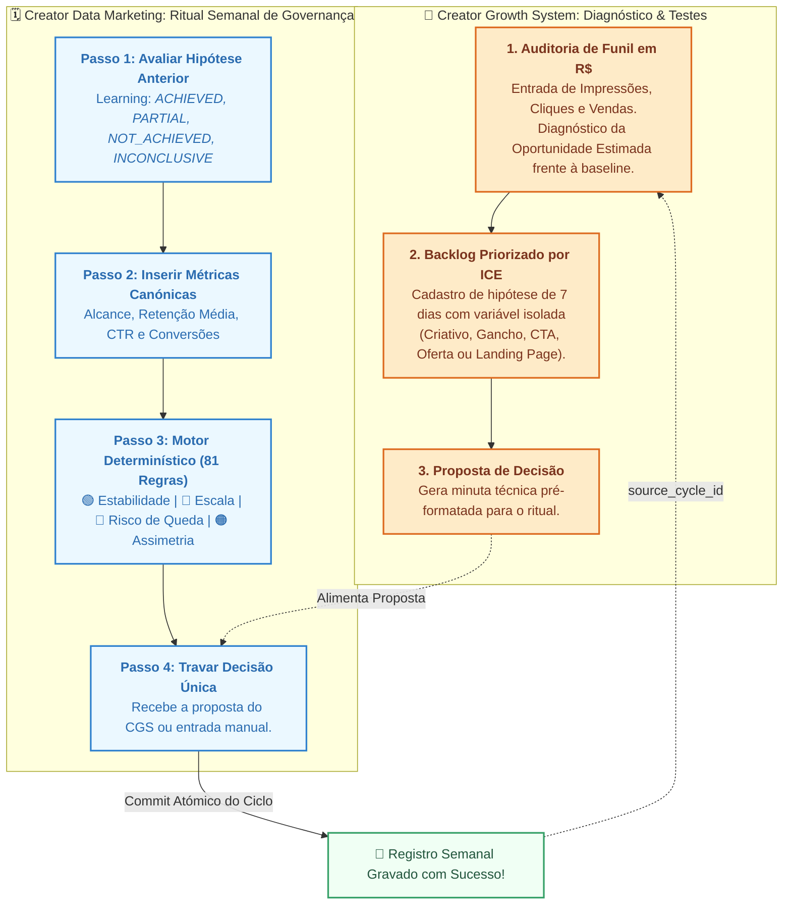

# 🎯 Creator Data Marketing & Growth Suite

Plataforma integrada de governança analítica semanal, diagnóstico de oportunidade de funil e experimentação operacional estruturada para criadores de conteúdo e gestores de mídia/tráfego.

O projeto segue rigorosamente o padrão **Spec-Driven Development (SDD)**, **Clean Architecture**, **Ports & Adapters (Arquitetura Hexagonal)** e empacotamento canónico Python em monólito modular via `src/` layout (PEP 517/621).

---

## 🧭 Visão Geral da Suíte Integrada

A suíte resolve a separação entre **governança de saúde** e **motor de aceleração**:

| Módulo | Papel Metodológico | Entregáveis Principais | Especificação |
| :--- | :--- | :--- | :--- |
| **CDMS**<br>*(Creator Data Marketing)* | **Governança & Ritual**<br>Foco na linha de base, eliminação de métricas de vaidade e trava de decisão por ciclo. | • Ritual semanal em 4 passos<br>• Motor determinístico (81 combinações)<br>• Idempotência (`cycle_id = YYYY-MM-DD`)<br>• Snapshots imutáveis e auditoria | `docs/SDD-CDMS-001-v2.3.1.md` |
| **CGS**<br>*(Creator Growth System)* | **Experimentação & Funil**<br>Diagnóstico de quebra monetária em $R\$$, backlog priorizado por ICE e hipóteses de 7 dias. | • Auditoria de oportunidade em $R\$<br>• Cálculo bancário via `Decimal`<br>• Ranking ICE ($Impact \times Conf \times Ease / 10$)<br>• Proposta de decisão para o CDMS | `docs/sdd-cgs-001.md` |

---

## 🔄 Como Funciona a Dinâmica dos Dois Módulos

O sistema orquestra governança e aceleração em circuito fechado:



---

## 🏗️ Arquitetura do Sistema (`src/` layout)

```text
cdms-project/
├── pyproject.toml                     # Configuração de empacotamento (PEP 517/621)
├── pytest.ini                         # Configurações do Pytest
├── README.md                          # Documentação consolidada da suíte
├── .gitignore                         # Isolamento de caches e data/*.db
├── app.py                             # Bootstrap central da aplicação Streamlit
├── data/
│   └── .gitkeep                       # Diretório da base SQLite local
├── docs/
│   ├── SDD-CDMS-001-v2.3.1.md         # SDD formal do CDMS (Governança & Ritual)
│   └── sdd-cgs-001.md                 # SDD formal do CGS v1.1.0 (Funil & Growth)
├── tests/
│   ├── unit/
│   │   ├── test_metrics.py            # Validação numérica de snapshots e calibração
│   │   ├── test_diagnose_scenario.py  # Teste exaustivo das 81 combinações heurísticas
│   │   └── test_run_weekly_ritual.py  # Teste de orquestração e idempotência do ritual
│   └── integration/
│       └── test_sqlite_repo.py        # Testes de persistência e isolamento transacional
└── src/
    ├── cdms/                          # Módulo de Governança e Decisão Semanal
    │   ├── config/                    # Settings e Container de Injeção de Dependências
    │   ├── domain/                    # Entidades puras e ScenarioClassifier
    │   ├── application/               # Portas (RepositoryPort) e Casos de Uso
    │   └── adapters/
    │       ├── persistence/           # SQLite nativo e migração 001_initial_schema.sql
    │       └── ui/                    # Telas e componentes do Ritual Semanal
    └── cgs/                           # Módulo de Oportunidade e Experimentação
        ├── domain/
        │   ├── entities/              # FunnelBaseline, FunnelOpportunityAudit, GrowthHypothesis
        │   └── services/              # FunnelOpportunityAnalyzer (cálculo puro em Decimal)
        ├── application/
        │   ├── ports/                 # GrowthRepositoryPort
        │   └── use_cases/             # Auditoria de funil, gestão de backlog e proposta CDMS
        └── adapters/
            ├── persistence/           # SQLiteGrowthRepository e migração 002_cgs_schema.sql
            └── ui/                    # growth_engine_page.py (Diagnóstico, ICE e Baselines)
```

---

## 🚀 Instalação e Execução

### 1. Requisitos

* Python 3.11+
* Git

### 2. Configurar o Ambiente Virtual

```bash
# Criar ambiente virtual
python -m venv .venv

# Ativar no Linux / macOS:
source .venv/bin/activate

# Ativar no Windows (PowerShell):
.venv\Scripts\Activate.ps1
```

### 3. Instalar o Pacote em Modo Editável

```bash
pip install --upgrade pip
pip install -e ".[dev]"
```

### 4. Executar os Testes Automatizados

A suíte cobre 100% dos testes unitários e de integração descritos nas especificações:

```bash
pytest
```

### 5. Iniciar a Aplicação Streamlit

```bash
streamlit run app.py
```

O painel estará disponível em `http://localhost:8501`.

---

## 📊 Regras Operacionais dos Motores

### 1. Motor Heurístico do CDMS (Cascata de Precedência Estrita)
Avalia as 4 métricas canónicas (`reach`, `avg_retention_pct`, `ctr_pct`, `conversions`) contra suas faixas saudáveis:

| Precedência | Cenário | Condição Lógica Estrita | Cobertura Teórica |
| :---: | :--- | :--- | :---: |
| **1** | `PRE_DROP` (Risco de Queda) | $\ge 2$ métricas em `BELOW` | 33 combinações (40.7%) |
| **2** | `ANOMALY` (Assimetria Crítica) | $\ge 1$ métrica em `BELOW` e $\ge 1$ métrica em `ABOVE` | 28 combinações (34.6%) |
| **3** | `SCALE` (Alavancagem de Escala) | $0$ métricas em `BELOW` e $\ge 2$ métricas em `ABOVE` | 11 combinações (13.6%) |
| **4** | `STABILITY` (Equilíbrio Nominal) | $0$ métricas em `BELOW` e $\le 1$ métrica em `ABOVE` | 5 combinações (6.2%) |
| **Fallback** | `INCONCLUSIVE` (Sinais Mistos) | $1$ métrica em `BELOW` e $3$ em `HEALTHY` | 4 combinações (4.9%) |

### 2. Motor de Oportunidade Financeira do CGS
Calcula a oportunidade estimada frente à linha de base calibrada sem inferência espúria de dados:
* **Entradas Explícitas:** Impressões, Cliques observados e Vendas/Conversões (sem estimar cliques multiplicando alcance por CTR).
* **Precisão Decimal:** Valores tratados com classe `Decimal` e arredondamento `ROUND_HALF_UP`.
* **Desempate Estável de Gargalo:** Quando as oportunidades de Intenção e Conversão empatam positivamente, o sistema classifica como `CONVERSION` devido à proximidade direta com o fluxo de caixa.

### 3. Matriz de Priorização ICE
$$\text{ICE Score} = \frac{\text{Impacto (1-10)} \times \text{Confiança (1-10)} \times \text{Facilidade (1-10)}}{10}$$
* Ordenação estável: `ice_score DESC`, `created_at ASC`, `id ASC`.

---

## 💾 Banco de Dados, Integridade e Backups

* **Base Unificada:** `data/cdms_dev.db` gerenciada nativamente via `sqlite3`.
* **Migrações Aplicadas Automaticamente:**
  * `001_initial_schema.sql`: Tabelas do CDMS (`rituals`, `metric_snapshots`, `decisions`, `learnings`).
  * `002_cgs_schema.sql`: Tabelas do CGS (`growth_baselines`, `funnel_opportunity_audits`, `growth_hypotheses`).
* **Backup Consistente a Frio (Aplicação Fechada):**
  ```bash
  sqlite3 data/cdms_dev.db ".backup 'data/backup_suite_$(date +%Y%m%d).db'"
  ```

---

## 🗺️ Roadmap de Evolução

* **Fase 1 (MVP Local - Concluída):** Monólito modular Streamlit + SQLite com CDMS operacional e CGS desacoplado em `src/cgs`.
* **Fase 2 (Nuvem & Multi-Tenant):** Endpoints REST via FastAPI, migração para PostgreSQL, autenticação OAuth2/JWT e workspaces multi-canal.
* **Fase 3 (Automação & IA):** Ingestão automática via APIs de plataformas (YouTube, Meta, TikTok) e sugestão heurística de hipóteses assistida por LLMs.