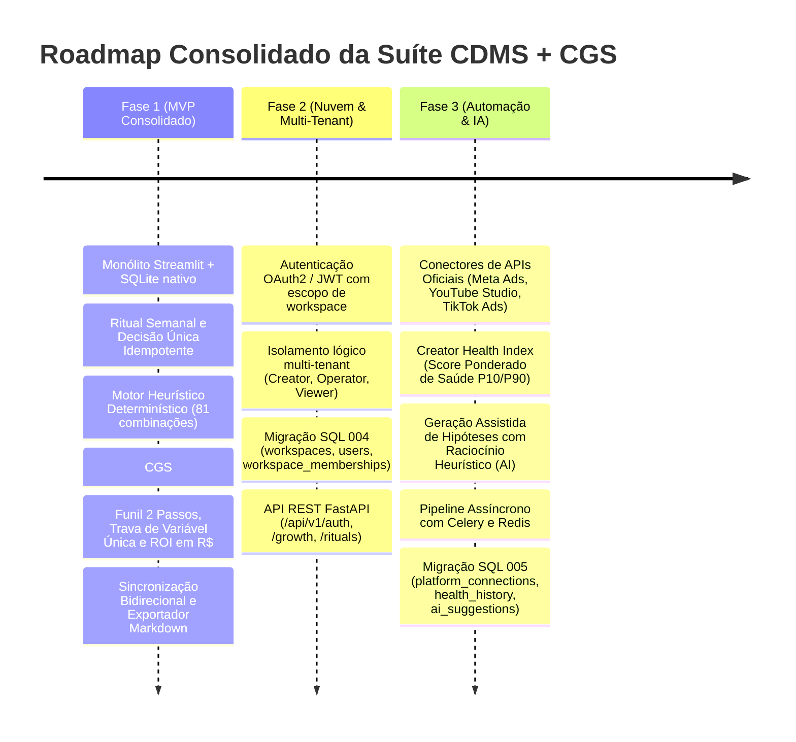
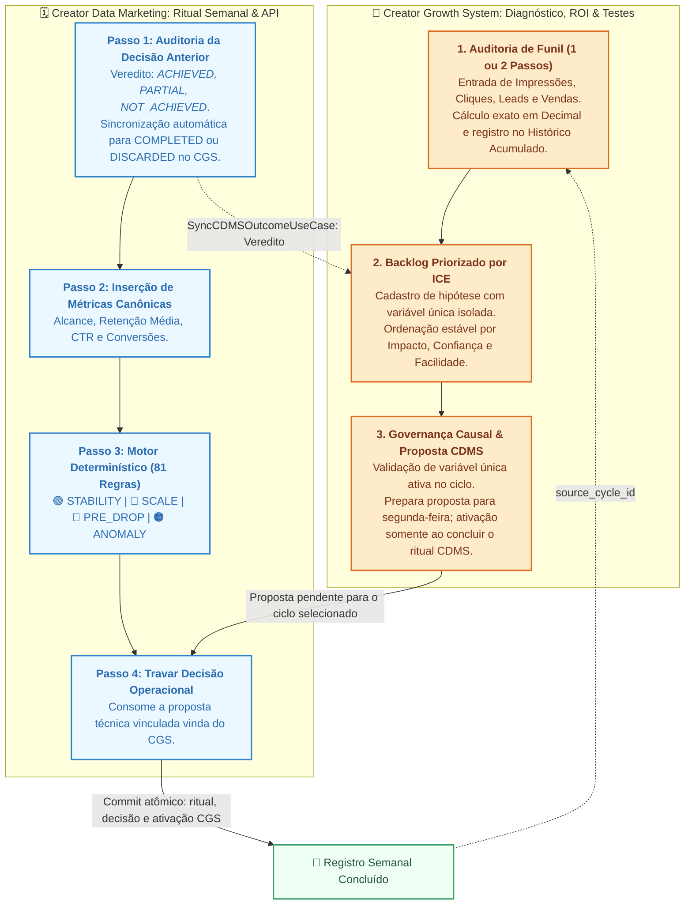

# 🎯 Creator Data Marketing & Growth Suite (CDMS + CGS)

Plataforma integrada de governança analítica semanal, diagnóstico de oportunidade de receita de funil e experimentação operacional estruturada para criadores de conteúdo e gestores de tráfego/mídia.

A solução é construída com base em **Spec-Driven Development (SDD)**, **Clean Architecture**, **Ports & Adapters (Hexagonal)** e layout modular canônico Python `src/` (PEP 517/621).

---

## 🧭 Visão Geral da Suíte Integrada

A suíte unifica a **governança de saúde e rituais** ao **motor de aceleração e experimentação de hipóteses**, cobrindo o ciclo operacional completo:

| Módulo | Papel Metodológico | Entregáveis Principais | Especificação |
| :--- | :--- | :--- | :--- |
| **CDMS**<br>*(Creator Data Marketing)* | **Governança, Ritual & Plataforma**<br>Linha de base, eliminação de métricas de vaidade, classificação heurística determinística e trava de decisão única por ciclo. | • Ritual semanal em 4 passos com idempotência (`cycle_id = YYYY-MM-DD`)<br>• Motor determinístico exaustivo (81 combinações)<br>• API REST Multi-Tenant (FastAPI + JWT)<br>• Ingestão automatizada (Meta, YouTube, TikTok) e Celery | `docs/SDD-CDMS-001-v2.4.0.md`<br>`docs/FASE_2_CDMS_MULTI_TENANT_API.md` |
| **CGS**<br>*(Creator Growth System)* | **Experimentação & Funil**<br>Diagnóstico financeiro de perdas em $R\$$, priorização determinística por ICE Score, governança causal e ciclo de 7 dias. | • Diagnóstico de funil: Venda Direta (`DIRECT_SALE`) e 2 Passos (`LEAD`)<br>• Histórico cumulativo de oportunidades e ROI de governança<br>• Trava causal de variável única (`ConflictingActiveVariableError`)<br>• Sincronização bidirecional atômica com as Decisões do CDMS | `docs/SDD-CGS-001-v1_2_0.md` |

---

## 🗺️ Roadmap de Evolução por Fases



---

## 🔄 Dinâmica de Circuito Fechado (CDMS $\leftrightarrow$ CGS)

O fluxo entre os dois subsistemas atua em circuito fechado e transacional:



---

## ⚡ Recursos Técnicos e de Governança

### 1. Fase 1: Núcleo de Governança e Motor de Experimentação

* **Loop Fechado de Hipóteses**: Máquina de estados explícita (`PENDING` / `BACKLOG` $\rightarrow$ `ACTIVE` $\rightarrow$ `COMPLETED` / `DISCARDED`).
* **Funil em 2 Passos (`ConversionType.LEAD`)**: Decomposição em `Decimal` das perdas em Intenção (CTR), Captura de Leads (opt-in) e Fechamento Comercial (venda).
* **Trava Causal de Variável Única**: Disparo da exceção de domínio `ConflictingActiveVariableError` impedindo experimentos concorrentes sobre a mesma variável (`CREATIVE`, `HOOK`, `CTA`, `OFFER`, `LANDING_PAGE`) no mesmo ciclo semanal.
* **Painel de Histórico e ROI**: Métricas de redução de desperdício financeiro entre ciclos, tabela auditável e gráficos de barras empilhadas.
* **Exportador em Markdown**: Geração estruturada do relatório executivo do ciclo via `ExportCycleReportUseCase`.

### 2. Fase 2: Nuvem, Multi-Tenant e API REST

* **Isolamento por Workspace na API**: Identidade central e um banco SQLite operacional por UUID de workspace, escolhido pelo servidor após validar o vínculo do usuário. Perfis: `OWNER`, `ADMIN`, `MEMBER` e `VIEWER`.
* **Autenticação JWT**: Login com usuário ativo e vínculo persistido; senhas novas com PBKDF2-SHA256 e leitura de hashes bcrypt legados. JWT exige chave externa, emissor, audiência e expiração. Logout e troca de senha revogam tokens anteriores.
* **API REST FastAPI**: Endpoints de autenticação, membros, baseline, auditorias, hipóteses, rituais, orçamento e otimização em `/api/v1`. Consulte `/docs` e [o guia da etapa 4](docs/etapa-4-autenticacao-workspaces.md).
* **Identidade e dados operacionais**: A migração 004 cria `users`, `workspaces` e `workspace_members` no banco de identidade; cada workspace usa um arquivo próprio para rituais, decisões e hipóteses. O banco local legado não é migrado ou atribuído automaticamente a usuários.

### 3. Fase 3: Automação, Conectores e Inteligência Heurística

* **Conectores de Plataformas**: Porta `PlatformConnectorPort` e adaptadores para Meta Ads, YouTube Studio e TikTok Ads.
* **Creator Health Index**: Score ponderado de saúde operacional ($P_{10}/P_{90}$) com classificação em tiers (`EXCELLENT`, `HEALTHY`, `VULNERABLE`, `CRITICAL`).
* **Geração Assistida de Hipóteses (IA)**: Serviço `AIHypothesisGenerator` derivando ações causais, piso de corte e ICE Score a partir dos gargalos detectados.
* **Pipeline Assíncrono com Celery & Redis**: Tarefas distribuídas em background para sincronização de dados de mídia.
* **Migração 005**: Tabelas `platform_connections`, `creator_health_history` e `ai_hypothesis_suggestions`.

---

## 🏗️ Estrutura do Projeto (`src/` layout)

```text
cdms-project/
├── pyproject.toml                     # Metadados e dependências (PEP 517/621)
├── pytest.ini                         # Configuração do Pytest (testpaths = tests)
├── README.md                          # Documentação consolidada da suíte
├── app.py                             # Bootstrap central da aplicação Streamlit
├── data/
│   └── cdms_dev.db                    # Banco de dados SQLite persistente
├── docs/
│   ├── SDD-CDMS-001-v2.4.0.md         # SDD formal do CDMS (Governança, Ingestão & Rituais)
│   ├── SDD-CGS-001-v1_2_0.md          # SDD formal do CGS v1.2.0 (Funil & Governança Causal)
│   ├── FASE_2_CDMS_MULTI_TENANT_API.md# Especificação da Fase 2 (Nuvem, Multi-Tenant & JWT)
│   └── ROTEIRO_EXECUCAO_SUITE.md      # Roteiro operacional e de engenharia (Fases 1, 2 e 3)
├── tests/
│   ├── conftest.py                    # Fixtures globais, mocks de rede e notificações
│   ├── unit/
│   │   ├── test_metrics.py            # Validação numérica de snapshots e calibração
│   │   ├── test_diagnose_scenario.py  # Teste exaustivo das 81 regras de cenários do CDMS
│   │   ├── test_run_weekly_ritual.py  # Orquestração e idempotência do ritual semanal
│   │   ├── test_growth_hypothesis.py  # Entidade de hipótese e cálculo de ICE Score
│   │   ├── test_funnel_analyzer.py    # Auditoria de funil, desempates e validações
│   │   ├── test_export_cycle_report.py# Exportação de relatórios em Markdown
│   │   ├── test_notification_mocks.py # Mocks avançados de rede e envio de notificações
│   │   ├── test_fase2_api_auth.py     # Autenticação JWT e contexto de tenant
│   │   └── test_fase3_ai_and_connectors.py # Conectores, Health Index e IA
│   └── integration/
│       ├── test_sqlite_repo.py        # Persistência atômica do núcleo CDMS
│       ├── test_sqlite_growth_repo.py # Repositório SQLite CGS (migrações 2 e 3)
│       └── test_lifecycle_and_sync.py # Ciclo de vida, trava causal e sync CDMS <-> CGS
└── src/
    ├── cdms/                          # Módulo de Governança, API e Conectores
    │   ├── config/                    # Configurações, segurança e container de dependências
    │   ├── domain/                    # Entidades canônicas, Health Index e ScenarioClassifier
    │   ├── application/               # Portas de conectores, repositórios e Casos de Uso
    │   └── adapters/
    │       ├── api/                   # Routers FastAPI, dependências e esquemas Pydantic
    │       ├── connectors/            # Adaptadores de APIs de mídia (Meta, YouTube, TikTok)
    │       ├── parsers/               # PlatformMetricsParser (CSV/XLSX)
    │       ├── persistence/           # SQLite nativo e migrações 001, 004 e 005
    │       ├── tasks/                 # Worker e tarefas assíncronas Celery/Redis
    │       └── ui/                    # Componentes e telas do Ritual Semanal
    └── cgs/                           # Módulo de Oportunidade, Funil e Experimentação
        ├── domain/
        │   ├── entities/              # FunnelBaseline, FunnelOpportunityAudit, GrowthHypothesis
        │   └── services/              # FunnelOpportunityAnalyzer (cálculo em Decimal)
        ├── application/
        │   ├── ports/                 # GrowthRepositoryPort e NotificationServicePort
        │   └── use_cases/             # Auditoria de funil, backlog ICE, propostas e relatórios
        └── adapters/
            ├── notifications/         # MockNotificationService para testes e alertas
            ├── persistence/           # SQLiteGrowthRepository (migrações 002 e 003)
            └── ui/                    # growth_engine_page.py (Diagnóstico, ICE, Baselines e Relatórios)
```

---

## 🚀 Instalação e Execução

### 1. Requisitos

* Python 3.11+
* Git
* Redis (opcional para tarefas assíncronas da Fase 3)

### 2. Configurar o Ambiente Virtual

```bash
# Criar o ambiente virtual
python -m venv .venv

# Ativar no Windows (PowerShell):
.venv\Scripts\Activate.ps1

# Ativar no Linux / macOS:
source .venv/bin/activate

# Atualizar pip
python -m pip install --upgrade pip
```

### 3. Instalar o Projeto em Modo Editável e Dependências

```bash
# Instalação completa para desenvolvimento e testes
pip install -e ".[dev,api,automation]"

# Alternativa equivalente para instalar a suíte completa
pip install -r requirements.txt

# Instalações parciais: interface e testes, API ou automação
# pip install -e ".[dev]"
# pip install -e ".[api]"
# pip install -e ".[automation]"
```

### 4. Executar os Testes Automatizados

Execute a suíte automatizada com os extras `dev`, `api` e `automation` instalados. Os testes usam bancos temporários e conectores simulados; não comprovam integração real com plataformas externas:

```bash
pytest -v
```

### 5. Iniciar as Interfaces e Serviços

* **Interface Streamlit (Painel Interativo):**
  
  ```bash
  streamlit run app.py
  ```

  Acesse em `http://localhost:8501`.

* **API REST FastAPI (Nuvem / Multi-Tenant):**

  ```bash
  # Configure antes CDMS_SECRET_KEY com pelo menos 32 bytes aleatórios.
  # Provisione usuário e workspace conforme o guia da etapa 4.
  uvicorn cdms.adapters.api.main:app --reload --port 8000
  ```

  Documentação Swagger disponível em `http://localhost:8000/docs`.

* **Worker Assíncrono Celery (Tarefas em Segundo Plano):**

  ```bash
  celery -A cdms.adapters.tasks.celery_app worker --loglevel=info
  ```

---

## 💾 Persistência e Esquema de Banco de Dados

* **Base Unificada:** `data/cdms_dev.db` gerenciada nativamente.
* **Migração 001 (CDMS Core):** Tabelas `rituals`, `metric_snapshots`, `decisions`, `learnings`.
* **Migração 002 (CGS Base):** Tabelas `growth_baselines`, `funnel_opportunity_audits`, `growth_hypotheses`.
* **Migração 003 (CGS Governança & Funil de 2 Passos):** Colunas `leads_opportunity_reais` e `closing_opportunity_reais` e índices de unicidade de variável ativa.
* **Migração 004 (Fase 2 Multi-Tenant):** Tabelas `workspaces`, `users`, `workspace_memberships` e partição por `workspace_id`.
* **Migração 005 (Fase 3 Automação & IA):** Tabelas `platform_connections`, `creator_health_history` e `ai_hypothesis_suggestions`.

Backup consistente com a aplicação fechada:

```bash
sqlite3 data/cdms_dev.db ".backup 'data/backup_cdms_$(date +%Y%m%d).db'"
```


## Validação da interface e fluxo integrado

Os testes em `tests/ui/` executam o ponto de entrada `app.py` com `streamlit.testing.v1.AppTest`, datas fixas e banco SQLite temporário compartilhado entre CDMS e CGS. Não é necessário iniciar um servidor ou conectar contas de mídia.

```powershell
.\.venv\Scripts\python.exe -m pytest -q tests/ui
```

Fluxo manual para uma hipótese CGS:

1. No CGS, salve a baseline comercial e execute o diagnóstico para uma segunda-feira de referência.
2. Cadastre a hipótese no backlog e escolha a segunda-feira em **Ciclo alvo da proposta CDMS**.
3. Clique em **Preparar para Ritual CDMS**. A hipótese permanece pendente até o ritual ser concluído.
4. No CDMS, escolha a mesma segunda-feira e selecione a hipótese em **Proposta CGS para este ciclo**.
5. Confira as métricas e a decisão preenchida; conclua o ritual. A decisão e o vínculo CGS são gravados juntos, e a hipótese passa para `ACTIVE`.
6. No ritual seguinte, após o prazo de avaliação, registre o resultado e as evidências da decisão anterior. `ACHIEVED` e `PARTIAL` concluem a hipótese; `NOT_ACHIEVED` a descarta. `INCONCLUSIVE` preserva o estado ativo.
7. Consulte o histórico e a prévia do relatório no CGS.

A validação automatizada cobre comportamento e persistência. Aparência visual no navegador, upload real de arquivos e integrações externas exigem verificações próprias.


## Autenticação e workspaces da API

A API exige `CDMS_SECRET_KEY` e não aceita a chave demonstrativa antiga. O comando abaixo provisiona um proprietário e um workspace, solicitando a senha sem eco no terminal:

```powershell
.\.venv\Scripts\python.exe -m cdms.adapters.api.bootstrap --email owner@example.com --name "Proprietário" --workspace "Meu workspace"
```

Use o UUID retornado no login de `/api/v1/auth/login`. O servidor verifica o vínculo a cada requisição; enviar outro `workspace_id` em cabeçalhos ou payload não troca o armazenamento autenticado. `VIEWER` pode ler os dados, enquanto `MEMBER`, `ADMIN` e `OWNER` podem executar operações de negócio. Apenas `OWNER` e `ADMIN` gerenciam membros, com restrições para alterar administradores e proteger o proprietário.

O Streamlit continua sendo a interface local do banco `data/cdms_dev.db`. Ele não passa a ser uma interface multiusuário autenticada por esta alteração. [Configuração e limites da etapa 4](docs/etapa-4-autenticacao-workspaces.md).
