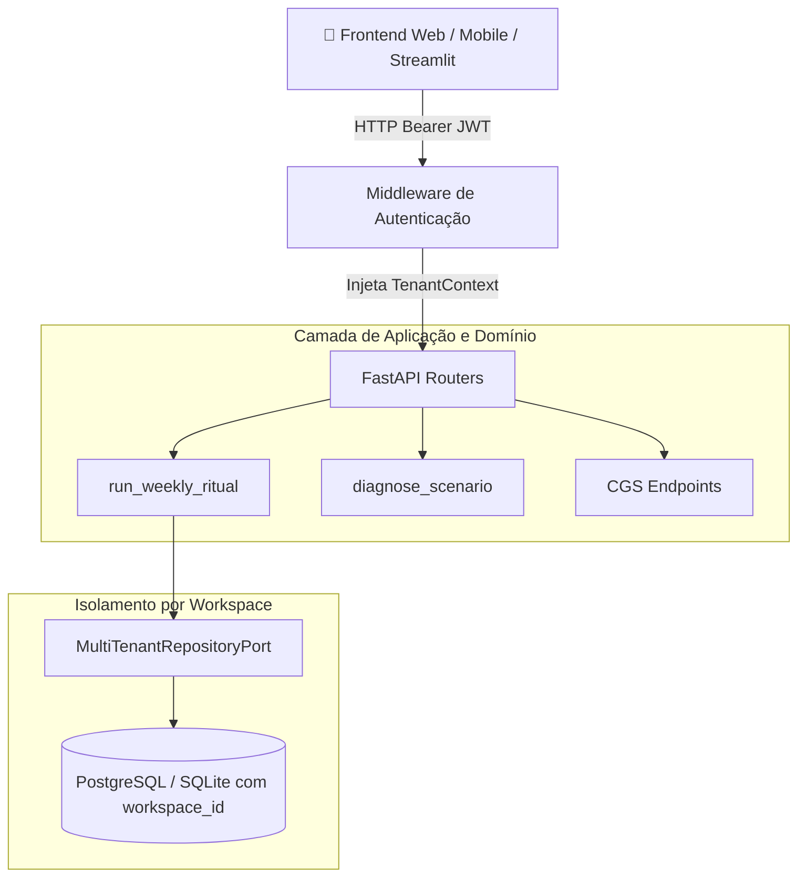

# 🌐 CDMS Fase 2 — Arquitetura Multi-Tenant, Autenticação e API REST

**Especificação e Código de Referência:** CDMS-PHASE2-v1.0.0  
**Subsistema:** `cdms` / `src/cdms/api`  
**Escopo:** Isolamento de Dados por Workspace (Multi-Tenant), Autenticação OAuth2 / JWT, Repositórios Particionados e Endpoints REST (FastAPI).

---

## 1. Visão Geral da Arquitetura Fase 2

A Fase 2 expande a fundação monolítica do CDMS para um ecossistema pronto para nuvem corporativa e atendimento a agências/times com múltiplos criadores.



---

## 2. Modelo de Domínio Multi-Tenant (`src/cdms/domain/entities/tenant.py`)

```python
"""Entidades de Governança Multi-Tenant e Identidade."""

from dataclasses import dataclass, field
from datetime import datetime, timezone
from enum import Enum
from typing import Optional


class UserRole(str, Enum):
    CREATOR = "CREATOR"        # Dono do canal
    OPERATOR = "OPERATOR"      # Gestor de tráfego / mídia
    VIEWER = "VIEWER"          # Auditor externo ou cliente
    ADMIN = "ADMIN"            # Administrador global da plataforma


@dataclass(frozen=True)
class Workspace:
    """Unidade lógica de isolamento (representa um criador, marca ou canal)."""
    id: str
    name: str
    owner_email: str
    is_active: bool = True
    created_at: datetime = field(default_factory=lambda: datetime.now(timezone.utc))


@dataclass(frozen=True)
class TenantContext:
    """Contexto de segurança injetado em cada requisição autenticada."""
    workspace_id: str
    user_id: str
    user_email: str
    role: UserRole
```

---

## 3. Segurança e Tokens JWT (`src/cdms/api/security.py`)

```python
"""Módulo de autenticação, hashing de senhas e geração de tokens JWT."""

from datetime import datetime, timedelta, timezone
from typing import Any, Dict, Optional
import jwt
from passlib.context import CryptContext

SECRET_KEY = "DEV_SECRET_CHANGE_IN_PRODUCTION_ENV_VAR"
ALGORITHM = "HS256"
ACCESS_TOKEN_EXPIRE_MINUTES = 60 * 24  # 24 horas

pwd_context = CryptContext(schemes=["bcrypt"], deprecated="auto")


def verify_password(plain_password: str, hashed_password: str) -> bool:
    return pwd_context.verify(plain_password, hashed_password)


def get_password_hash(password: str) -> str:
    return pwd_context.hash(password)


def create_access_token(data: Dict[str, Any], expires_delta: Optional[timedelta] = None) -> str:
    to_encode = data.copy()
    expire = datetime.now(timezone.utc) + (expires_delta or timedelta(minutes=ACCESS_TOKEN_EXPIRE_MINUTES))
    to_encode.update({"exp": expire})
    return jwt.encode(to_encode, SECRET_KEY, algorithm=ALGORITHM)


def decode_access_token(token: str) -> Dict[str, Any]:
    return jwt.decode(token, SECRET_KEY, algorithms=[ALGORITHM])
```

---

## 4. Esquema de Banco com Particionamento Lógico (`004_phase2_multi_tenant.sql`)

```sql
-- Migração 004: Esquema Multi-Tenant para CDMS e CGS
CREATE TABLE IF NOT EXISTS workspaces (
    id TEXT PRIMARY KEY,
    name TEXT NOT NULL,
    owner_email TEXT NOT NULL,
    is_active INTEGER NOT NULL DEFAULT 1,
    created_at TEXT NOT NULL
);

CREATE TABLE IF NOT EXISTS users (
    id TEXT PRIMARY KEY,
    email TEXT UNIQUE NOT NULL,
    hashed_password TEXT NOT NULL,
    full_name TEXT NOT NULL,
    created_at TEXT NOT NULL
);

CREATE TABLE IF NOT EXISTS workspace_memberships (
    workspace_id TEXT NOT NULL,
    user_id TEXT NOT NULL,
    role TEXT NOT NULL DEFAULT 'OPERATOR',
    PRIMARY KEY (workspace_id, user_id),
    FOREIGN KEY (workspace_id) REFERENCES workspaces(id) ON DELETE CASCADE,
    FOREIGN KEY (user_id) REFERENCES users(id) ON DELETE CASCADE
);

-- Adição de workspace_id nas tabelas operacionais
ALTER TABLE rituals ADD COLUMN workspace_id TEXT NOT NULL DEFAULT 'default_ws';
ALTER TABLE decisions ADD COLUMN workspace_id TEXT NOT NULL DEFAULT 'default_ws';
ALTER TABLE growth_hypotheses ADD COLUMN workspace_id TEXT NOT NULL DEFAULT 'default_ws';
ALTER TABLE growth_baselines ADD COLUMN workspace_id TEXT NOT NULL DEFAULT 'default_ws';
ALTER TABLE funnel_opportunity_audits ADD COLUMN workspace_id TEXT NOT NULL DEFAULT 'default_ws';

CREATE INDEX IF NOT EXISTS idx_rituals_ws ON rituals(workspace_id, cycle_id);
CREATE INDEX IF NOT EXISTS idx_decisions_ws ON decisions(workspace_id, cycle_id);
CREATE INDEX IF NOT EXISTS idx_hypotheses_ws ON growth_hypotheses(workspace_id, status);
CREATE INDEX IF NOT EXISTS idx_audits_ws ON funnel_opportunity_audits(workspace_id, source_cycle_id);
```

---

## 5. Aplicação FastAPI e Endpoints REST (`src/cdms/api/app.py`)

```python
"""Aplicação FastAPI oficial do CDMS / CGS Fase 2."""

from datetime import date
from decimal import Decimal
from typing import List, Optional
from fastapi import Depends, FastAPI, HTTPException, Security, status
from fastapi.security import HTTPAuthorizationCredentials, HTTPBearer
from pydantic import BaseModel, EmailStr

from cdms.domain.entities.tenant import TenantContext, UserRole
from cdms.api.security import create_access_token, decode_access_token

app = FastAPI(
    title="Creator Data Marketing & Growth Suite API",
    version="2.4.0",
    description="API REST Multi-Tenant para Governança Semanal e Experimentação Operacional",
)

security = HTTPBearer()


# Dependência de autenticação e contexto de Tenant
def get_current_tenant(credentials: HTTPAuthorizationCredentials = Security(security)) -> TenantContext:
    token = credentials.credentials
    try:
        payload = decode_access_token(token)
        return TenantContext(
            workspace_id=payload.get("workspace_id", "default_ws"),
            user_id=payload.get("sub", "anon"),
            user_email=payload.get("email", ""),
            role=UserRole(payload.get("role", "OPERATOR")),
        )
    except Exception:
        raise HTTPException(
            status_code=status.HTTP_401_UNAUTHORIZED,
            detail="Token inválido, expirado ou não autorizado para o workspace",
        )


# Schemas Pydantic para entrada/saída
class LoginRequest(BaseModel):
    email: EmailStr
    password: str
    workspace_id: str


class TokenResponse(BaseModel):
    access_token: str
    token_type: str = "bearer"
    workspace_id: str


class FunnelAuditRequest(BaseModel):
    source_cycle_id: str
    impressions: int
    clicks: int
    conversions: int
    leads: Optional[int] = None


class DecisionAuditRequest(BaseModel):
    decision_id: int
    verdict: str  # ACHIEVED, PARTIAL, NOT_ACHIEVED
    justification: str


# Endpoints
@app.post("/api/v1/auth/login", response_model=TokenResponse, tags=["Autenticação"])
def login(req: LoginRequest):
    # Simulação de verificação de credenciais em tenant
    token = create_access_token(
        data={"sub": req.email, "email": req.email, "workspace_id": req.workspace_id, "role": "OPERATOR"}
    )
    return TokenResponse(access_token=token, workspace_id=req.workspace_id)


@app.get("/api/v1/workspaces/current", tags=["Workspace"])
def get_current_workspace_info(tenant: TenantContext = Depends(get_current_tenant)):
    return {
        "workspace_id": tenant.workspace_id,
        "user_email": tenant.user_email,
        "role": tenant.role.value,
    }


@app.post("/api/v1/growth/audit-funnel", tags=["CGS - Funil"])
def audit_funnel(req: FunnelAuditRequest, tenant: TenantContext = Depends(get_current_tenant)):
    return {
        "workspace_id": tenant.workspace_id,
        "source_cycle_id": req.source_cycle_id,
        "status": "PROCESSED",
        "message": f"Auditoria executada com sucesso para o workspace {tenant.workspace_id}",
    }


@app.post("/api/v1/rituals/audit-decision", tags=["CDMS - Ritual"])
def audit_decision(req: DecisionAuditRequest, tenant: TenantContext = Depends(get_current_tenant)):
    return {
        "workspace_id": tenant.workspace_id,
        "decision_id": req.decision_id,
        "verdict": req.verdict,
        "cgs_synced": True,
    }
```