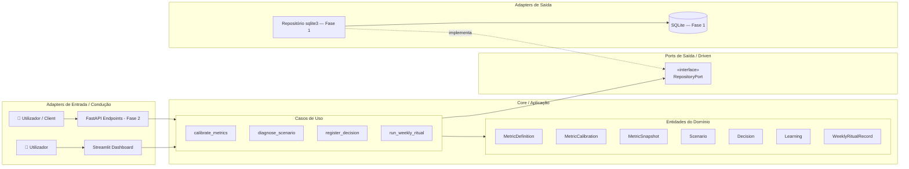
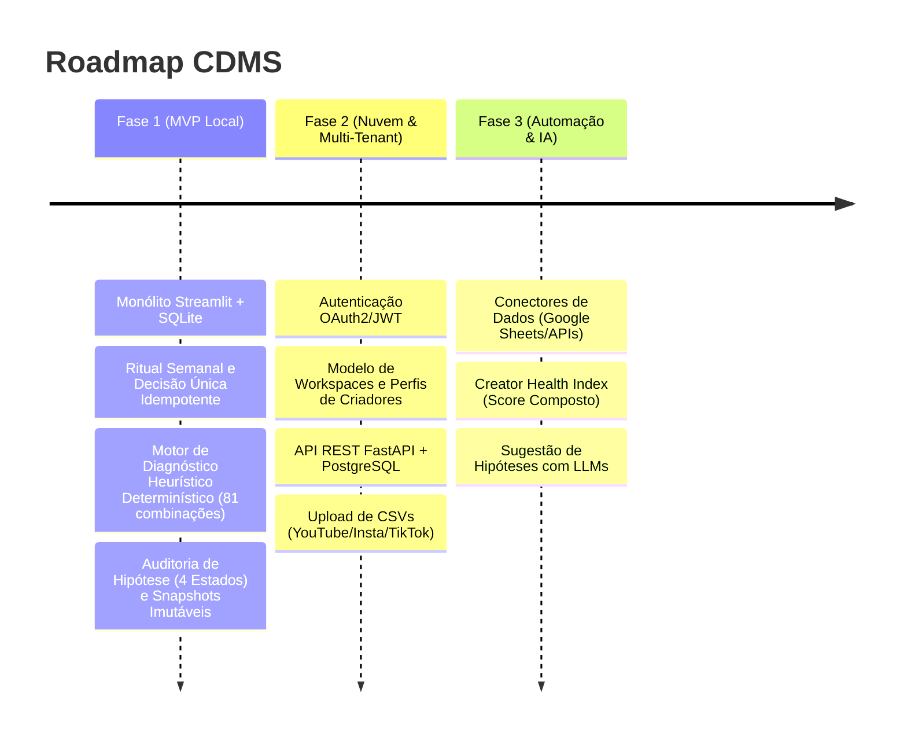

# 📑 SDD — Creator Data Marketing System (CDMS)

**Versão:** 2.3.1 (Revisão de Integridade, Idempotência e Critérios Operacionais)  
**Padrão:** Spec-Driven Development (SDD) com Clean Architecture, Hexagonal (Ports & Adapters) e Monólito Modular  
**Layout de Empacotamento:** Python `src/` layout (PEP 517/621 via `pyproject.toml`)

---

## 1. Visão Geral e Princípios Arquiteturais

O **Creator Data Marketing System (CDMS)** é uma plataforma voltada à tomada de decisão data-driven para criadores de conteúdo e gestores de tráfego/mídia. O foco do sistema é o **Ritual Semanal**: transformar dados dispersos em calibração de métricas, diagnóstico heurístico de momento operacional (sinais de alerta e tração) e o compromisso formal com uma **Decisão Única por Ciclo**, estabelecendo um circuito fechado de auditoria de hipóteses.

### Princípios de Engenharia:
* **Core Isolado e Agnóstico:** O domínio de regras puras e entidades não possui dependências de frameworks de infraestrutura (FastAPI, Streamlit, SQLAlchemy, Pydantic).
* **Imutabilidade Histórica:** As observações e diagnósticos do passado registram a calibração de faixas vigentes no momento do ritual. Alterações futuras nas metas não reescrevem o histórico.
* **Governança por Idempotência:** Cada ciclo semanal possui identificador canônico unívoco (`cycle_id = YYYY-MM-DD` da segunda-feira de referência), prevenindo duplicidades em disparos repetidos de interface.
* **Diagnóstico Heurístico em Cascata com Precedência Estrita:** Regras com ordem de avaliação explícita e cobertura exaustiva (eliminando ambiguidades e separando dados faltantes de dispersão de sinais).



---

## 2. Roadmap Estratégico de Evolução



| Fase | Foco Principal | Stack Tecnológica | Entregáveis Chave |
| :--- | :--- | :--- | :--- |
| **Fase 1 (MVP)** | Validação da metodologia semanal (Single Process) | Python 3.11+, Streamlit, SQLite nativo | Ritual semanal em 4 etapas, motor determinístico em cascata com cobertura exaustiva, snapshots de métricas, decisões atômicas e exportação em Markdown. |
| **Fase 2 (Multi-Tenant)** | Compartilhamento, equipes e persistência em nuvem | FastAPI, PostgreSQL, Alembic, OAuth2/JWT | Workspaces para criadores/agências, ingestão por planilhas/CSVs, histórico analítico. |
| **Fase 3 (Automação & IA)** | Retenção, escalabilidade e síntese inteligente | Celery/Redis, Conectores de API, Agentes LLM | Extração automática de métricas, alertas de anomalia e hipóteses assistidas por IA. |

---

## 3. Especificação Detalhada da Fase 1 (MVP)

### 3.1. Dicionário e Catálogo Operacional de Métricas

**Contexto único:** o MVP atende a um criador em um canal, com objetivo de conversão definido (leads ou vendas). Canal, fórmula de CTR e tipo de conversão permanecem constantes no histórico desse contexto. Múltiplos canais e workspaces pertencem à Fase 2. Mudanças que tornem dados incomparáveis exigem um novo contexto de análise na evolução do produto.

O MVP adota 4 métricas canônicas obrigatórias:

| Métrica | Identificador (`key`) | Unidade | Fórmula / Definição Operacional | Agregação Semanal | Tratamento de Denominador Zero |
| :--- | :--- | :--- | :--- | :--- | :--- |
| **Alcance Semanal** | `reach` | Usuários únicos | Total de contas/usuários únicos alcançados no canal principal | Deduplicado pela plataforma de origem | Não aplicável ($\ge 0$) |
| **Retenção Média** | `avg_retention_pct` | Percentual (`%`) | Média do tempo assistido relativo à duração do conteúdo | Média ponderada pelo volume de visualizações | Visualizações $= 0 \implies$ Indisponível (`NO_EXPOSURE`) |
| **Taxa de Cliques (CTR)** | `ctr_pct` | Percentual (`%`) | $(\text{Cliques Registrados} / \text{Impressões Totais}) \times 100$ | Soma dos cliques $/$ Soma das impressões | Impressões $= 0 \implies$ Indisponível (`ZERO_IMPRESSIONS`) |
| **Conversões** | `conversions` | Eventos (un) | Contagem total de eventos de fundo de funil (leads ou vendas) | Soma simples dos eventos concluídos | Não aplicável ($\ge 0$) |

---

### 3.2. Modelo de Dados com Desacoplamento Temporal

```python
from dataclasses import dataclass, field
from datetime import datetime, date, timezone
from enum import Enum
from typing import List, Optional
import math

class MetricStatus(str, Enum):
    HEALTHY = "HEALTHY"
    BELOW = "BELOW"
    ABOVE = "ABOVE"

class HypothesisOutcome(str, Enum):
    ACHIEVED = "ACHIEVED"          # Meta atingida
    PARTIAL = "PARTIAL"            # Meta parcialmente atingida
    NOT_ACHIEVED = "NOT_ACHIEVED"  # Meta não atingida
    INCONCLUSIVE = "INCONCLUSIVE"  # Inconclusivo / Fatores externos

class InconclusiveReason(str, Enum):
    MISSING_DATA = "MISSING_DATA"    # Faltam métricas obrigatórias ou métricas indisponíveis
    MIXED_SIGNALS = "MIXED_SIGNALS"  # Vetor completo com dispersão de sinais sem enquadramento

class ScenarioType(str, Enum):
    PRE_DROP = "PRE_DROP"          # Risco de Queda: alerta operacional em indicadores líderes
    ANOMALY = "ANOMALY"            # Assimetria Crítica entre etapas do funil
    SCALE = "SCALE"                # Múltiplas métricas acima das faixas; sem inferência temporal
    STABILITY = "STABILITY"        # Equilíbrio Operacional nominal
    INCONCLUSIVE = "INCONCLUSIVE"  # Sem enquadramento conclusivo

@dataclass(frozen=True)
class MetricDefinition:
    key: str
    name: str
    unit: str
    description: str

@dataclass(frozen=True)
class MetricCalibration:
    metric_key: str
    healthy_min: float
    healthy_max: float

    def __post_init__(self):
        for val, name in [(self.healthy_min, "healthy_min"), (self.healthy_max, "healthy_max")]:
            if isinstance(val, bool) or not isinstance(val, (int, float)):
                raise ValueError(f"{name} deve ser numérico.")
            if math.isnan(val) or math.isinf(val):
                raise ValueError(f"{name} não pode ser NaN ou Infinito.")
            if val < 0:
                raise ValueError(f"{name} deve ser um valor não-negativo.")
        if self.healthy_min > self.healthy_max:
            raise ValueError(f"healthy_min ({self.healthy_min}) não pode ser maior que healthy_max ({self.healthy_max}).")

@dataclass(frozen=True)
class MetricSnapshot:
    definition: MetricDefinition
    calibration: MetricCalibration
    observed_value: Optional[float]
    is_available: bool = True
    unavailability_reason: Optional[str] = None

    def __post_init__(self):
        if self.definition.key != self.calibration.metric_key:
            raise ValueError(f"Chave de definição '{self.definition.key}' incompatível com calibração '{self.calibration.metric_key}'.")
        if not self.is_available:
            if self.observed_value is not None or not self.unavailability_reason:
                raise ValueError("Métrica indisponível exige valor None e motivo.")
            return
        if self.unavailability_reason is not None:
            raise ValueError("Métrica disponível não pode conter motivo de indisponibilidade.")
        if isinstance(self.observed_value, bool) or not isinstance(self.observed_value, (int, float)):
            raise ValueError("Valor observado deve ser numérico.")
        if self.is_available:
            if self.observed_value is None or math.isnan(self.observed_value) or math.isinf(self.observed_value):
                raise ValueError(f"Métrica disponível '{self.definition.key}' deve conter um valor numérico finito.")
            if self.observed_value < 0:
                raise ValueError(f"Valor observado de '{self.definition.key}' não pode ser negativo.")

        if self.definition.key in {"reach", "conversions"}:
            if not float(self.observed_value).is_integer():
                raise ValueError("Contagens devem ser inteiras.")

    def status(self) -> Optional[MetricStatus]:
        if not self.is_available or self.observed_value is None:
            return None
        if self.observed_value < self.calibration.healthy_min:
            return MetricStatus.BELOW
        elif self.observed_value > self.calibration.healthy_max:
            return MetricStatus.ABOVE
        return MetricStatus.HEALTHY

    def deviation_pct(self) -> Optional[float]:
        st = self.status()
        if st is None:
            return None
        if st == MetricStatus.HEALTHY:
            return 0.0
        if st == MetricStatus.BELOW:
            if self.calibration.healthy_min == 0:
                return None
            return round(((self.observed_value - self.calibration.healthy_min) / self.calibration.healthy_min) * 100, 2)
        else:
            if self.calibration.healthy_max == 0:
                return None
            return round(((self.observed_value - self.calibration.healthy_max) / self.calibration.healthy_max) * 100, 2)

@dataclass
class Scenario:
    type: ScenarioType
    description: str
    recommendation: str
    evidence_metric_keys: List[str]
    inconclusive_reason: Optional[InconclusiveReason] = None

@dataclass
class Decision:
    id: Optional[int]
    cycle_id: str
    summary: str
    hypothesis: str
    success_criterion: str
    evaluation_due_date: date
    owner: str = "Creator"
    recorded_at: datetime = field(default_factory=lambda: datetime.now(timezone.utc))

@dataclass
class Learning:
    id: Optional[int]
    target_decision_id: int
    target_decision_summary: str
    outcome: HypothesisOutcome
    evidence_notes: str
    recorded_at: datetime = field(default_factory=lambda: datetime.now(timezone.utc))

@dataclass
class WeeklyRitualRecord:
    id: Optional[int]
    cycle_id: str                 # Formato canônico: 'YYYY-MM-DD' (segunda-feira de referência)
    week_start: date
    snapshots: List[MetricSnapshot]
    scenario: Scenario
    decision: Decision
    learning: Optional[Learning] = None
    rules_version: str = "2.3.1"
    completed_at: datetime = field(default_factory=lambda: datetime.now(timezone.utc))
```

### 3.2.1. Validações e significado dos resultados

- Toda decisão exige ação, hipótese, critério de sucesso verificável e prazo de avaliação. O critério descreve resultado atingido, parcial e não atingido. Resultado observado não comprova causalidade.
- Os limites admissíveis de retenção e CTR são declarados na configuração do canal, inclusive possibilidade de valores acima de 100%. Aplicam-se a observações e calibrações. Não é permitido alterar a fórmula no mesmo histórico.
- Cliques e impressões do CTR devem medir o mesmo escopo e período. Dados manuais de retenção devem seguir o método ponderado do catálogo ou o agregado equivalente fornecido pela origem.
- Métrica indisponível exige valor `None` e motivo; disponível exige valor finito não negativo e ausência de motivo. Contagens são inteiras.
- `None` em desvio significa cálculo indisponível, exibido como “Não calculável”; não equivale a 0%.
- `rules_version` é atribuído pelo classificador/caso de uso conforme a regra efetivamente executada, e não pelo formulário.

---

### 3.3. Tabela de Decisão do Motor Heurístico (Cascata de Precedência Estrita)

A classificação é executada pelo serviço puro `ScenarioClassifier`. Antes da cascata, há uma **Etapa de Guarda**:
1. O vetor de snapshots deve conter **exatamente as 4 chaves canônicas** (`reach`, `avg_retention_pct`, `ctr_pct`, `conversions`) sem duplicatas nem chaves desconhecidas. Qualquer divergência retorna `INCONCLUSIVE / MISSING_DATA`, com descrição da inconsistência.
2. Todas as 4 métricas devem ter `is_available == True`. Se alguma for indisponível ou faltar, o motor retorna imediatamente:
   `INCONCLUSIVE` com motivo `MISSING_DATA`.

Uma vez validadas as 4 métricas, o motor processa o espaço exaustivo das **81 combinações ($3^4$)** na ordem de precedência abaixo. A primeira regra satisfeita define o resultado único:

| Precedência | Cenário | Condição Lógica Estrita | Cobertura Teórica | Diretriz Tática |
| :---: | :--- | :--- | :---: | :--- |
| **1** | `PRE_DROP`<br>(Risco de Queda) | $\text{count}(\text{BELOW}) \ge 2$ | 33 combinações (40.7%) | **Ação Corretiva:** Investigar os indicadores abaixo da referência e priorizar uma ação coerente com as evidências. |
| **2** | `ANOMALY`<br>(Assimetria Crítica) | $\text{count}(\text{BELOW}) \ge 1 \text{ E } \text{count}(\text{ABOVE}) \ge 1$ | 28 combinações (34.6%) | **Investigação:** Examinar a assimetria entre os indicadores abaixo e acima das referências. |
| **3** | `SCALE`<br>(Alavancagem de Escala) | $\text{count}(\text{BELOW}) == 0 \text{ E } \text{count}(\text{ABOVE}) \ge 2$ | 11 combinações (13.6%) | **Expansão Gradual:** Avaliar expansão conforme objetivo, capacidade e indicadores envolvidos. |
| **4** | `STABILITY`<br>(Equilíbrio Operacional) | $\text{count}(\text{BELOW}) == 0 \text{ E } \text{count}(\text{ABOVE}) \le 1$ | 5 combinações (6.2%) | **Consistência e Testes A/B:** Otimizações incrementais sem romper a cadência de publicação. |
| **Fallback** | `INCONCLUSIVE`<br>(Sinais Mistos) | $\text{count}(\text{BELOW}) == 1 \text{ E } \text{count}(\text{ABOVE}) == 0$ (1 BELOW e 3 HEALTHY) | 4 combinações (4.9%) | **Observação Diligente:** Monitorar o indicador isolado sem alterar o rumo estratégico. Motivo: `MIXED_SIGNALS`. |

As porcentagens abaixo representam cobertura lógica, não probabilidade de ocorrência. `PRE_DROP` indica risco operacional, sem previsão de queda futura; `SCALE` indica valores acima das referências, sem comprovar crescimento temporal. Explicações e recomendações devem citar os indicadores efetivamente envolvidos.

*Total Coberto:* $33 + 28 + 11 + 5 + 4 = 81$ combinações (100% do domínio).

---

### 3.4. Governança, Idempotência e Seleção Temporal

1. **Ciclo:** `cycle_id = week_start.isoformat()`. A referência é a segunda-feira no fuso `settings.TIMEZONE`. A decisão deve pertencer ao mesmo ciclo do ritual. Timestamps são armazenados em UTC com fuso; `completed_at` é atribuído pelo caso de uso ao finalizar.
2. **Conteúdo equivalente:** compara-se o conteúdo de negócio submetido: ciclo, snapshots com definições e calibrações, ação, hipótese, responsável, critério e prazo da decisão, além da avaliação anterior quando houver. Excluem-se IDs gerados, timestamps, diagnóstico derivado e versão corrente do motor. Snapshots são ordenados por chave; números equivalentes (10 e 10.0) são normalizados sem usar arredondamento de apresentação. Textos são comparados após normalização de quebras de linha e remoção de espaços externos, preservando espaços internos.
3. **Ordem da finalização:** validar e normalizar a submissão; consultar o ciclo existente antes de buscar outra decisão pendente. Conteúdo equivalente retorna o registro original, inclusive diagnóstico e versão. Conteúdo divergente lança `CycleAlreadyClosedError`. Apenas para ciclo novo, validar a decisão anterior explicitamente selecionada, classificar e persistir.
4. **Atomicidade:** ritual, snapshots, cenário, decisão e eventual aprendizado são gravados em uma transação. Falha provoca rollback integral. `UNIQUE(cycle_id)` é obrigatório. Em conflito concorrente, consultar o registro vencedor e aplicar a mesma política de equivalência.
5. **Aprendizado:** `UNIQUE(target_decision_id)` garante no máximo uma avaliação por decisão. O alvo deve pertencer a ciclo anterior, não ter avaliação e ter prazo atingido em `evaluation_as_of`. O vínculo explícito submetido é revalidado na transação; não é substituído silenciosamente por outro alvo.
6. **Pendências:** a consulta recebe `before_week_start` e `evaluation_as_of` (data local da avaliação). Havendo várias decisões elegíveis, apresenta a mais recente e informa a existência de outras. Um ritual avalia no máximo uma decisão anterior. Primeiro ritual ou ausência de alvo elegível dispensa a etapa.
7. **Correções:** ciclos concluídos não são sobrescritos. Edição de ritual finalizado fica fora do MVP e exigirá revisão rastreável.
8. **Invariantes:** segunda-feira obrigatória; coerência de cycle_id/semana/decisão; `INCONCLUSIVE` exige motivo e outros cenários não o admitem. Essas regras são verificadas pelo domínio/caso de uso, além das restrições de persistência aplicáveis.

---

### 3.5. Contratos da Porta de Persistência (`RepositoryPort`)

```python
from abc import ABC, abstractmethod
from typing import List, Optional
from datetime import date
from cdms.domain.entities.weekly_ritual import WeeklyRitualRecord
from cdms.domain.entities.decision import Decision
from cdms.domain.entities.metric import MetricCalibration

class RepositoryPort(ABC):
    @abstractmethod
    def save_ritual_atomic(self, ritual: WeeklyRitualRecord) -> WeeklyRitualRecord:
        """Persiste atomicamente o ritual semanal em transação única."""
        pass

    @abstractmethod
    def get_ritual_by_cycle(self, cycle_id: str) -> Optional[WeeklyRitualRecord]:
        """Recupera o ritual pelo identificador de ciclo."""
        pass

    @abstractmethod
    def get_pending_decision(self, before_week_start: date, evaluation_as_of: date) -> Optional[Decision]:
        """Recupera a decisão anterior mais recente sem Learning e com prazo de avaliação atingido em evaluation_as_of."""
        pass

    @abstractmethod
    def list_rituals(self, limit: int = 20) -> List[WeeklyRitualRecord]:
        """Lista rituais em ordem cronológica decrescente."""
        pass

    @abstractmethod
    def save_metric_calibration(self, calibration: MetricCalibration) -> None:
        """Salva limites de calibração para uma métrica."""
        pass

    @abstractmethod
    def get_active_calibrations(self) -> List[MetricCalibration]:
        """Obtém as calibrações vigentes."""
        pass
```

---

## 4. Estrutura Canônica de Diretórios (`src/` layout)

```text
cdms-project/
├── pyproject.toml                     # Centralização de dependências e metadados (PEP 621)
├── README.md                          # Documentação do projeto
├── .gitignore
├── app.py                             # Bootstrap leve da aplicação Streamlit
├── data/
│   └── .gitkeep                       # Diretório para o cdms_dev.db (SQLite)
├── docs/
│   └── sdd-cdms-001.md                # SDD e especificações de evolução
├── tests/
│   ├── unit/
│   │   ├── test_metrics.py            # Testes de snapshot, calibração, divisão zero e NaN
│   │   ├── test_diagnose_scenario.py  # Teste exaustivo das 81 combinações (parametrized)
│   │   └── test_run_weekly_ritual.py  # Testes de fluxo de caso de uso
│   └── integration/
│       └── test_sqlite_repo.py        # Testes de persistência transacional e idempotência
└── src/
    └── cdms/
        ├── __init__.py
        ├── config/
        │   ├── __init__.py
        │   ├── settings.py            # Definição de paths, timezone e defaults
        │   └── container.py           # Injeção de dependências e Composition Root
        ├── domain/
        │   ├── __init__.py
        │   ├── entities/
        │   │   ├── __init__.py
        │   │   ├── metric.py          # MetricDefinition, MetricCalibration, MetricSnapshot
        │   │   ├── scenario.py        # Scenario, ScenarioType, InconclusiveReason
        │   │   ├── decision.py        # Decision
        │   │   ├── learning.py        # Learning, HypothesisOutcome
        │   │   └── weekly_ritual.py   # WeeklyRitualRecord
        │   └── services/
        │       ├── __init__.py
        │       └── scenario_classifier.py # Regras puras em cascata (81 combinações)
        ├── application/
        │   ├── __init__.py
        │   ├── ports/
        │   │   ├── __init__.py
        │   │   └── repository.py      # RepositoryPort
        │   └── use_cases/
        │       ├── __init__.py
        │       ├── calibrate_metrics.py
        │       ├── diagnose_scenario.py
        │       ├── run_weekly_ritual.py
        │       ├── get_history.py
        │       └── export_ritual.py   # Geração de relatório Markdown
        └── adapters/
            ├── __init__.py
            ├── persistence/
            │   ├── __init__.py
            │   ├── sqlite_repo.py     # SQLite com isolamento transacional
            │   ├── schema.sql
            │   └── migrations/
            └── ui/
                ├── __init__.py
                ├── streamlit_app.py   # Interface do ritual semanal em 4 passos
                ├── components/        # Widgets reutilizáveis
                └── styles/
                    └── main.css
```

---

## 5. Critérios de Aceite para a Fase 1

1. **Determinismo Heurístico:** Cada uma das 81 combinações teóricas possíveis entre as 4 métricas resulta de forma determinística no cenário previsto pela tabela de precedência.
2. **Guarda de Integridade:** Tentativas de classificação com métricas ausentes, duplicadas ou com denominador nulo (`is_available == False`) retornam imediatamente `INCONCLUSIVE (MISSING_DATA)`.
3. **Imutabilidade Histórica:** A recalibração de limites em semanas futuras não altera os snapshots, desvios percentuais ou diagnósticos de rituais concluídos.
4. **Idempotência Estrita:** Submissão repetida com o mesmo `cycle_id` e mesmo conteúdo retorna o registro existente; conteúdo divergente gera `CycleAlreadyClosedError`.
5. **Robustez Numérica:** Valores inválidos, incluindo `NaN` e infinito, são rejeitados por validação com mensagem compreensível. Indisponibilidade e referência zero no cálculo de desvio retornam `None`; a interface não apresenta esses casos como desvio zero.
6. **Rastreabilidade de Aprendizado:** Cada `Learning` fica estritamente atrelado a uma decisão prévia (`target_decision_id`) anterior à data do ciclo em execução.


## 6. Operação e Interface do MVP

### 6.1. Configuração e ritual

A configuração inicial registra canal, objetivo de conversão, definição operacional das métricas, limites admissíveis e quatro calibrações. Sem calibrações válidas, a finalização é bloqueada com orientação para concluir a configuração.

O ritual contém quatro passos:
1. Avaliar a decisão anterior elegível, ou informar que não há avaliação pendente elegível.
2. Informar valores semanais ou marcar indisponibilidade com motivo.
3. Revisar diagnóstico, evidências e recomendações condicionais.
4. Registrar ação, hipótese, responsável, critério e prazo; revisar e finalizar.

A indisponibilidade permite concluir um ritual com diagnóstico inconclusivo, desde que explicitada. Erros de validação preservam os dados do formulário e impedem a gravação. O estado transitório da interface não é fonte de verdade para registros concluídos. O histórico é carregado da persistência.

### 6.2. Persistência, backup e migrações

O MVP usa `sqlite3` da biblioteca padrão; SQLAlchemy não é dependência de execução. Toda conexão habilita chaves estrangeiras. Migrações são numeradas e registradas em tabela de versão; a inicialização aplica migrações pendentes em ordem e interrompe a abertura em caso de falha. Realizar backup antes de migração de banco existente.

Banco, backups e arquivos transitórios ficam fora do Git. O README documenta backup consistente pela API de backup SQLite e restauração com a aplicação parada, preservando uma cópia do banco substituído. Após restaurar, verificar integridade, versão do esquema e leitura do histórico.

O acesso do MVP é local. Acesso compartilhado depende da autenticação e isolamento da Fase 2.

### 6.3. Histórico e exportação

O histórico apresenta período, indicadores, cenário, decisão e aprendizados. A exportação Markdown usa o registro persistido e inclui valores disponíveis/indisponíveis, motivos, faixas históricas, diagnóstico, evidências, versão das regras, decisão, critério, prazo e aprendizado com identificação do alvo. Quando uma decisão recebe avaliação em ritual posterior, a consulta mostra esse vínculo sem reescrever o snapshot original.

## 7. Critérios de Aceite Complementares

7. Reenvio idempotente não seleciona outra decisão nem recalcula o diagnóstico original, mesmo após atualização do motor.
8. Falha em qualquer etapa da gravação provoca rollback integral; submissões concorrentes respeitam a unicidade e a equivalência de conteúdo.
9. Ciclo, segunda-feira, decisão, disponibilidade e motivo de cenário respeitam as invariantes.
10. Explicações e recomendações correspondem às métricas que motivaram o cenário, sem afirmar causalidade ou previsão temporal.
11. O Markdown exportado preserva dados históricos, versão das regras, meta e prazo.
12. Backup e restauração documentados recuperam banco íntegro e histórico consultável.
13. Primeiro acesso, ausência de decisão elegível, múltiplas pendências e métricas indisponíveis possuem os fluxos definidos na seção 6.

## 8. Registro da Revisão 2.3.1

Consolidação da versão 2.3.0 com correções de desvio indisponível, contrato de calibrações, validação numérica, invariantes, meta e prazo, idempotência sem dependência de IDs e horários, elegibilidade temporal, recomendações baseadas em evidências e operação local. Mantidos o escopo de canal único, a arquitetura de diretórios e a classificação em 81 combinações.
