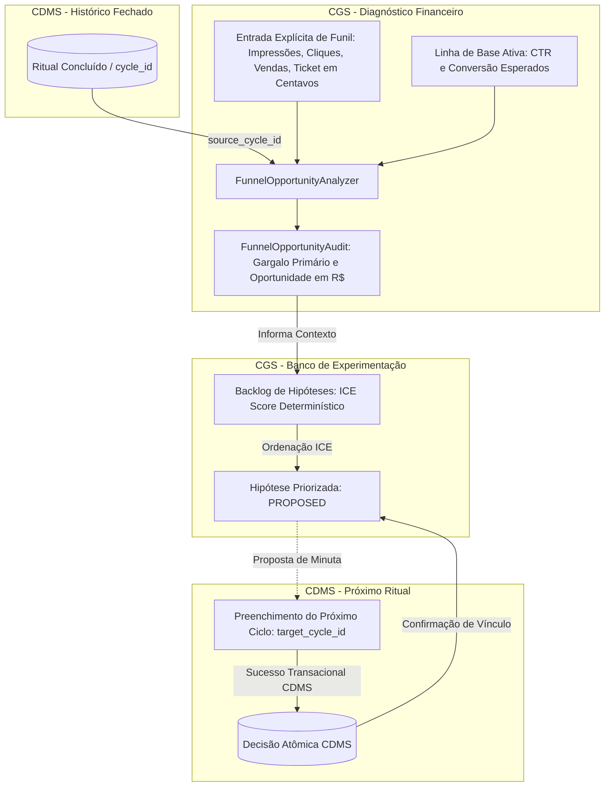

# 📑 SDD — Creator Growth System (CGS)

**Documento:** SDD-CGS-001  
**Versão:** 1.1.0 (Revisão Crítica de Integridade Financeira, Desacoplamento Temporal e Contratos de Integração)  
**Padrão:** Spec-Driven Development (SDD) com Clean Architecture, Hexagonal (Ports & Adapters) e Monólito Modular  
**Subsistema Alvo:** Pacote `src/cgs` (integrado ao workspace monólito existente via `src/` layout)  
**Subsistema a Montante:** `cdms` (CDMS v2.3.1)  

---

## 1. Visão Geral e Princípios Arquiteturais

O **Creator Growth System (CGS)** atua como a infraestrutura de **experimentação operacional estruturada** e auditoria de oportunidade financeira da operação de criadores de conteúdo e gestores de mídia. 

Enquanto o CDMS gerencia a governança e o fechamento atômico do ritual semanal (saúde das métricas e mitigação de vaidade), o CGS executa duas funções analíticas complementares:

1. **Auditoria de Oportunidade no Funil de Conversão:** Estima o potencial de receita incremental não capturado em relação a uma linha de base calibrada, identificando o gargalo operacional primário sem inferência espúria de causalidade ou reconstrução indevida de dados.
2. **Priorização e Governança de Hipóteses:** Gerencia o ciclo de vida de testes em janelas operacionais estruturadas (padrão de 7 dias), utilizando ordenação determinística por ICE Score (*Impact, Confidence, Ease*), piso de corte numérico e controle de exposição mínima.
3. **Proposta Desacoplada para o CDMS:** Gera minutas técnicas de decisão que alimentam o caso de uso `run_weekly_ritual` do CDMS, garantindo que o CGS nunca force escritas diretas ou concorrência destrutiva na base de rituais fechados.

### Princípios de Engenharia e Integridade:

* **Precisão Financeira Estrita:** Valores monetários são modelados e persistidos em centavos inteiros (`int`) ou tratados via `Decimal` de precisão fixa com arredondamento explícito (`ROUND_HALF_UP`), eliminando resíduos de ponto flutuante (`float`).
* **Qualificação Conceitual de Oportunidade:** Cálculos de desvio frente à baseline são explicitamente rotulados como *Oportunidade Estimada de Receita Frente à Referência* (e jamais como "receita perdida comprovada" ou "perda real").
* **Separação Temporal Estrita:** Diferenciação ontológica e transacional entre o ciclo que originou o diagnóstico (`source_cycle_id`) e o ciclo futuro planejado para a execução do teste (`target_cycle_id`).
* **Centralização Heurística:** Regras de classificação de gargalo e critérios de desempate residem em serviços puros de domínio, garantindo consistência semântica entre diagnósticos e relatórios.



---

## 2. Dicionário Operacional e Fórmulas de Oportunidade

### 2.1. Ingestão Explícita de Dados de Funil

O CGS **rejeita terminantemente a reconstrução de cliques ou impressões** a partir do `reach` (alcance de usuários únicos) do CDMS. As seguintes grandezas brutas devem ser fornecidas de forma direta e auditada para o escopo analisado:

| Parâmetro | Tipo | Unidade | Descrição Operacional |
| :--- | :--- | :--- | :--- |
| `impressions` | `int` | Exibições | Volume total de exposições do conteúdo no canal ($\ge 0$). |
| `clicks` | `int` | Eventos | Volume total de cliques verificados originados das impressões ($\le \text{impressions}$). |
| `conversions` | `int` | Eventos | Volume de ações finais concluídas (vendas diretas de produtos) ($\le \text{clicks}$). |
| `ticket_cents` | `int` | Centavos ($R\$$) | Preço médio ou ticket do item comercializado ($> 0$). |

*Nota Metodológica sobre Leads:* Caso o evento medido seja cadastro (Lead) e não venda imediata, a oportunidade financeira direta é suspensa, registrando apenas a oportunidade quantitativa de volume de leads, salvo se a taxa histórica de fechamento lead $\rightarrow$ venda for explicitamente declarada.

### 2.2. Fórmulas de Oportunidade Estimada de Receita

Sejam as taxas esperadas da linha de base calibrada declaradas em fração:
$$\tau_{\text{ctr\_ref}} = \frac{\text{CTR}_{\text{esperado}}\%}{100}, \quad \tau_{\text{conv\_ref}} = \frac{\text{TaxaConversão}_{\text{esperada}}\%}{100}$$

As taxas observadas no ciclo analisado são:
$$\tau_{\text{ctr\_obs}} = \begin{cases} \frac{\text{clicks}}{\text{impressions}}, & \text{se } \text{impressions} > 0 \\ 0, & \text{caso contrário} \end{cases}$$

$$\tau_{\text{conv\_obs}} = \begin{cases} \frac{\text{conversions}}{\text{clicks}}, & \text{se } \text{clicks} > 0 \\ 0, & \text{caso contrário} \end{cases}$$

Os gaps não-negativos de oportunidade são definidos por:
$$\Delta_{\text{ctr}} = \max\left(0.0, \, \tau_{\text{ctr\_ref}} - \tau_{\text{ctr\_obs}}\right)$$
$$\Delta_{\text{conv}} = \max\left(0.0, \, \tau_{\text{conv\_ref}} - \tau_{\text{conv\_obs}}\right)$$

As oportunidades estimadas de receita frente à referência (em centavos inteiros) são calculadas com arredondamento padrão `ROUND_HALF_UP`:
$$\text{Oportunidade}_{\text{intenção}} = \left\lfloor \left( \text{impressions} \times \Delta_{\text{ctr}} \times \tau_{\text{conv\_ref}} \times \text{ticket\_cents} \right) + 0.5 \right\rfloor$$
$$\text{Oportunidade}_{\text{conversão}} = \left\lfloor \left( \text{clicks} \times \Delta_{\text{conv}} \times \text{ticket\_cents} \right) + 0.5 \right\rfloor$$
$$\text{Oportunidade}_{\text{total}} = \text{Oportunidade}_{\text{intenção}} + \text{Oportunidade}_{\text{conversão}}$$

### 2.3. Heurística Centralizada de Identificação de Gargalo

A determinação do gargalo é implementada de forma única e centralizada no serviço de domínio, obedecendo à seguinte precedência estrita:

1. Se $\text{Oportunidade}_{\text{intenção}} == 0$ e $\text{Oportunidade}_{\text{conversão}} == 0$:
   $\implies \text{Gargalo} = \mathbf{NONE}$ (A operação opera estritamente dentro ou acima da referência).
2. Se $\text{Oportunidade}_{\text{conversão}} > \text{Oportunidade}_{\text{intenção}}$:
   $\implies \text{Gargalo} = \mathbf{CONVERSION}$ (A maior fuga de oportunidade reside no fechamento/checkout).
3. Se $\text{Oportunidade}_{\text{intenção}} > \text{Oportunidade}_{\text{conversão}}$:
   $\implies \text{Gargalo} = \mathbf{INTENTION}$ (A maior fuga reside na geração de tráfego qualificado e clique no CTA).
4. Em caso de empate ($\text{Oportunidade}_{\text{conversão}} == \text{Oportunidade}_{\text{intenção}} > 0$):
   $\implies \text{Gargalo} = \mathbf{CONVERSION}$ (Política de desempate: prioriza-se a etapa mais próxima do caixa imediato).

---

## 3. Modelo de Dados de Domínio (`src/cgs/domain/entities/`)

```python
from dataclasses import dataclass, field
from datetime import datetime, date, timezone
from decimal import Decimal, ROUND_HALF_UP
from enum import Enum
from typing import Optional
import math

class FunnelStage(str, Enum):
    NONE = "NONE"                # Nenhuma quebra crítica identificada frente à baseline
    INTENTION = "INTENTION"      # Quebra em Cliques / Engajamento com CTA
    CONVERSION = "CONVERSION"    # Quebra em Checkout / Vendas Finais

class VariableType(str, Enum):
    CREATIVE = "CREATIVE"        # Visual / Imagem / Formato de vídeo
    HOOK = "HOOK"                # Primeiros 3 segundos / Headline de abertura
    CTA = "CTA"                  # Chamada para ação / Clareza do destino
    OFFER = "OFFER"              # Preço / Condição / Bônus comercial
    LANDING_PAGE = "LANDING_PAGE" # Página de destino / Experiência pós-clique

class MetricDirection(str, Enum):
    HIGHER_IS_BETTER = "HIGHER_IS_BETTER" # Ex: CTR, Taxa de Conversão, Vendas
    LOWER_IS_BETTER = "LOWER_IS_BETTER"   # Ex: CPA, Rejeição, Fricção

class HypothesisStatus(str, Enum):
    BACKLOG = "BACKLOG"          # Em fila de priorização
    PROPOSED = "PROPOSED"        # Vinculada a uma minuta para o próximo ritual
    ACTIVE = "ACTIVE"            # Promovida e confirmada por ritual atômico do CDMS
    COMPLETED = "COMPLETED"      # Ciclo concluído e avaliado
    CANCELLED = "CANCELLED"      # Cancelada antes da execução
    ARCHIVED = "ARCHIVED"        # Obsoleta ou descartada do backlog

@dataclass(frozen=True)
class GrowthBaseline:
    id: Optional[int]
    name: str
    ticket_cents: int
    expected_ctr_pct: Decimal
    expected_conversion_rate_pct: Decimal
    is_active: bool = True
    created_at: datetime = field(default_factory=lambda: datetime.now(timezone.utc))

    def __post_init__(self):
        if isinstance(self.ticket_cents, bool) or not isinstance(self.ticket_cents, int):
            raise ValueError("ticket_cents deve ser um inteiro (centavos).")
        if self.ticket_cents <= 0:
            raise ValueError("ticket_cents deve ser estritamente positivo.")
        for rate, label in [(self.expected_ctr_pct, "expected_ctr_pct"), (self.expected_conversion_rate_pct, "expected_conversion_rate_pct")]:
            if not isinstance(rate, Decimal) or rate.is_nan() or rate.is_infinite():
                raise ValueError(f"{label} deve ser um Decimal válido e finito.")
            if not (Decimal("0.0") < rate <= Decimal("100.0")):
                raise ValueError(f"{label} deve estar no intervalo (0, 100].")

@dataclass(frozen=True)
class FunnelOpportunityAudit:
    id: Optional[int]
    source_cycle_id: str
    baseline_id: int
    impressions: int
    clicks: int
    conversions: int
    ticket_cents: int
    primary_bottleneck: FunnelStage
    intention_opportunity_cents: int
    conversion_opportunity_cents: int
    total_opportunity_cents: int
    diagnosis_summary: str
    calculated_at: datetime = field(default_factory=lambda: datetime.now(timezone.utc))

    def __post_init__(self):
        for val, name in [(self.impressions, "impressions"), (self.clicks, "clicks"), (self.conversions, "conversions")]:
            if isinstance(val, bool) or not isinstance(val, int) or val < 0:
                raise ValueError(f"{name} deve ser um inteiro não-negativo.")
        if self.clicks > self.impressions:
            raise ValueError("clicks não podem exceder impressions.")
        if self.conversions > self.clicks:
            raise ValueError("conversions não podem exceder clicks.")
        if self.intention_opportunity_cents < 0 or self.conversion_opportunity_cents < 0:
            raise ValueError("Oportunidades monetárias não podem ser negativas.")

    @property
    def total_opportunity_reais(self) -> Decimal:
        return (Decimal(self.total_opportunity_cents) / Decimal(100)).quantize(Decimal("0.01"), rounding=ROUND_HALF_UP)

@dataclass
class GrowthHypothesis:
    id: Optional[int]
    source_cycle_id: Optional[str]        # Ciclo do CDMS que motivou a hipótese
    target_cycle_id: Optional[str]        # Segunda-feira em que o teste será rodado
    action_description: str              # Ex: "Mudar gancho para pergunta provocativa"
    tested_variable: VariableType        # Variável isolada do teste
    metric_key: str                      # Métrica avaliada (ex: 'ctr_pct')
    metric_unit: str                     # Unidade (ex: '%', 'un', 'BRL')
    metric_direction: MetricDirection    # Direção de sucesso
    baseline_metric_value: Decimal       # Valor de referência inicial
    success_metric_target: Decimal       # Meta de sucesso
    invalidation_floor: Decimal          # Piso para descarte rápido
    min_exposure_threshold: int          # Volume mínimo de exposições/amostra
    external_factors_notes: str = ""     # Registro de ruídos/sazonalidades
    impact_score: int = 5                # Escala 1 a 10
    confidence_score: int = 5            # Escala 1 a 10
    ease_score: int = 5                  # Escala 1 a 10
    status: HypothesisStatus = HypothesisStatus.BACKLOG
    promoted_decision_id: Optional[int] = None # Vínculo com a Decision gerada no CDMS
    created_at: datetime = field(default_factory=lambda: datetime.now(timezone.utc))

    def __post_init__(self):
        for score, label in [(self.impact_score, "impact"), (self.confidence_score, "confidence"), (self.ease_score, "ease")]:
            if isinstance(score, bool) or not isinstance(score, int) or not (1 <= score <= 10):
                raise ValueError(f"{label}_score deve ser um inteiro estritamente entre 1 e 10.")
        
        for val, label in [(self.baseline_metric_value, "baseline"), (self.success_metric_target, "target"), (self.invalidation_floor, "floor")]:
            if not isinstance(val, Decimal) or val.is_nan() or val.is_infinite():
                raise ValueError(f"{label} deve ser um Decimal válido e finito.")

        if self.min_exposure_threshold < 0:
            raise ValueError("min_exposure_threshold deve ser não-negativo.")

        # Validação condicional à direção da métrica
        if self.metric_direction == MetricDirection.HIGHER_IS_BETTER:
            if self.invalidation_floor >= self.success_metric_target:
                raise ValueError("Para HIGHER_IS_BETTER, invalidation_floor deve ser estritamente menor que success_metric_target.")
        else:
            if self.invalidation_floor <= self.success_metric_target:
                raise ValueError("Para LOWER_IS_BETTER, invalidation_floor deve ser estritamente maior que success_metric_target.")

    @property
    def ice_score(self) -> Decimal:
        raw_score = (Decimal(self.impact_score * self.confidence_score * self.ease_score) / Decimal(10))
        return raw_score.quantize(Decimal("0.01"), rounding=ROUND_HALF_UP)
```

---

## 4. Serviços de Domínio Puro (`src/cgs/domain/services/`)

### 4.1. Analisador de Oportunidade Financeira (`FunnelOpportunityAnalyzer`)

Implementa o cálculo determinístico das oportunidades em centavos inteiros e a classificação do gargalo sem efeitos colaterais de I/O:

```python
class FunnelOpportunityAnalyzer:
    @staticmethod
    def audit_funnel(
        source_cycle_id: str,
        impressions: int,
        clicks: int,
        conversions: int,
        baseline: GrowthBaseline
    ) -> FunnelOpportunityAudit:
        if impressions < 0 or clicks < 0 or conversions < 0:
            raise ValueError("Contagens não podem ser negativas.")
        if clicks > impressions:
            raise ValueError("Cliques não podem ser maiores que impressões.")
        if conversions > clicks:
            raise ValueError("Conversões não podem ser maiores que cliques.")

        # Conversão de taxas esperadas para frações Decimais
        ctr_ref = baseline.expected_ctr_pct / Decimal("100.0")
        conv_ref = baseline.expected_conversion_rate_pct / Decimal("100.0")

        # Taxas observadas em Decimal
        ctr_obs = (Decimal(clicks) / Decimal(impressions)) if impressions > 0 else Decimal("0.0")
        conv_obs = (Decimal(conversions) / Decimal(clicks)) if clicks > 0 else Decimal("0.0")

        # Gaps de oportunidade (zero se desempenho for superior à referência)
        delta_ctr = max(Decimal("0.0"), ctr_ref - ctr_obs)
        delta_conv = max(Decimal("0.0"), conv_ref - conv_obs)

        # Cálculo de oportunidade em centavos (arredondamento ROUND_HALF_UP)
        ticket_dec = Decimal(baseline.ticket_cents)
        
        raw_intention_opp = Decimal(impressions) * delta_ctr * conv_ref * ticket_dec
        intention_opp_cents = int(raw_intention_opp.quantize(Decimal("1"), rounding=ROUND_HALF_UP))

        raw_conversion_opp = Decimal(clicks) * delta_conv * ticket_dec
        conversion_opp_cents = int(raw_conversion_opp.quantize(Decimal("1"), rounding=ROUND_HALF_UP))

        total_opp_cents = intention_opp_cents + conversion_opp_cents

        # Heurística Centralizada de Gargalo e Desempate
        if intention_opp_cents == 0 and conversion_opp_cents == 0:
            stage = FunnelStage.NONE
            summary = "Operação operando estritamente dentro ou acima das referências estabelecidas."
        elif conversion_opp_cents >= intention_opp_cents:
            stage = FunnelStage.CONVERSION
            reais = Decimal(conversion_opp_cents) / Decimal(100)
            summary = f"Gargalo primário em CONVERSÃO. Oportunidade estimada de R$ {reais:.2f} no checkout/fechamento."
        else:
            stage = FunnelStage.INTENTION
            reais = Decimal(intention_opp_cents) / Decimal(100)
            summary = f"Gargalo primário em INTENÇÃO. Oportunidade estimada de R$ {reais:.2f} na atração de cliques qualificados."

        return FunnelOpportunityAudit(
            id=None,
            source_cycle_id=source_cycle_id,
            baseline_id=baseline.id or 0,
            impressions=impressions,
            clicks=clicks,
            conversions=conversions,
            ticket_cents=baseline.ticket_cents,
            primary_bottleneck=stage,
            intention_opportunity_cents=intention_opp_cents,
            conversion_opportunity_cents=conversion_opp_cents,
            total_opportunity_cents=total_opp_cents,
            diagnosis_summary=summary
        )
```

---

## 5. Porta de Persistência (`GrowthRepositoryPort`)

A camada de aplicação acessa o armazenamento através de uma interface formal estrita:

```python
from abc import ABC, abstractmethod
from typing import List, Optional
from cgs.domain.entities.funnel import GrowthBaseline, FunnelOpportunityAudit
from cgs.domain.entities.hypothesis import GrowthHypothesis, HypothesisStatus

class GrowthRepositoryPort(ABC):
    @abstractmethod
    def save_baseline(self, baseline: GrowthBaseline) -> GrowthBaseline:
        """Persiste uma baseline de funil. Se is_active for True, desativa anteriores atomicamente."""
        pass

    @abstractmethod
    def get_active_baseline(self) -> Optional[GrowthBaseline]:
        """Recupera a única baseline atualmente ativa."""
        pass

    @abstractmethod
    def save_funnel_audit(self, audit: FunnelOpportunityAudit) -> FunnelOpportunityAudit:
        """Persiste a auditoria de oportunidade de funil associada a um source_cycle_id."""
        pass

    @abstractmethod
    def get_audit_by_source_cycle(self, source_cycle_id: str) -> Optional[FunnelOpportunityAudit]:
        """Recupera auditoria financeira de um ciclo de origem."""
        pass

    @abstractmethod
    def save_hypothesis(self, hypothesis: GrowthHypothesis) -> GrowthHypothesis:
        """Salva ou atualiza uma hipótese de teste."""
        pass

    @abstractmethod
    def get_hypothesis_by_id(self, hypothesis_id: int) -> Optional[GrowthHypothesis]:
        """Busca hipótese por ID primário."""
        pass

    @abstractmethod
    def list_hypotheses_ranked(self, status: Optional[HypothesisStatus] = None) -> List[GrowthHypothesis]:
        """Lista hipóteses com ordenação estável: ice_score DESC, created_at ASC, id ASC."""
        pass

    @abstractmethod
    def get_active_hypothesis_for_target_cycle(self, target_cycle_id: str) -> Optional[GrowthHypothesis]:
        """Garante a invariante de no máximo uma hipótese ativa por ciclo de execução."""
        pass

    @abstractmethod
    def bind_decision_to_hypothesis(self, hypothesis_id: int, cdms_decision_id: int) -> None:
        """Transiciona hipótese de PROPOSED para ACTIVE vinculando o ID persistido da Decision no CDMS."""
        pass
```

---

## 6. Esquema de Persistência SQLite (`002_cgs_schema.sql`)

A migração é registrada sob o identificador `002`, respeitando estritamente o esquema já provisionado pela migração `001_initial_schema.sql` do CDMS:

```sql
-- Migração 002: Esquema do Creator Growth System (CGS v1.1.0)
PRAGMA foreign_keys = ON;

CREATE TABLE IF NOT EXISTS growth_baselines (
    id INTEGER PRIMARY KEY AUTOINCREMENT,
    name TEXT NOT NULL,
    ticket_cents INTEGER NOT NULL,
    expected_ctr_pct TEXT NOT NULL,          -- Armazenado como string para precisão exata do Decimal
    expected_conversion_rate_pct TEXT NOT NULL,
    is_active INTEGER NOT NULL DEFAULT 1,
    created_at TEXT NOT NULL
);

-- Invariante de integridade: garante no máximo uma baseline ativa no banco
CREATE UNIQUE INDEX IF NOT EXISTS uq_cgs_single_active_baseline 
ON growth_baselines (is_active) 
WHERE is_active = 1;

CREATE TABLE IF NOT EXISTS funnel_opportunity_audits (
    id INTEGER PRIMARY KEY AUTOINCREMENT,
    source_cycle_id TEXT NOT NULL,
    baseline_id INTEGER NOT NULL,
    impressions INTEGER NOT NULL,
    clicks INTEGER NOT NULL,
    conversions INTEGER NOT NULL,
    ticket_cents INTEGER NOT NULL,
    primary_bottleneck TEXT NOT NULL,
    intention_opportunity_cents INTEGER NOT NULL,
    conversion_opportunity_cents INTEGER NOT NULL,
    total_opportunity_cents INTEGER NOT NULL,
    diagnosis_summary TEXT NOT NULL,
    calculated_at TEXT NOT NULL,
    FOREIGN KEY (source_cycle_id) REFERENCES rituals(cycle_id) ON DELETE RESTRICT,
    FOREIGN KEY (baseline_id) REFERENCES growth_baselines(id) ON DELETE RESTRICT
);

CREATE UNIQUE INDEX IF NOT EXISTS uq_cgs_audit_source_cycle 
ON funnel_opportunity_audits (source_cycle_id);

CREATE TABLE IF NOT EXISTS growth_hypotheses (
    id INTEGER PRIMARY KEY AUTOINCREMENT,
    source_cycle_id TEXT,
    target_cycle_id TEXT,
    action_description TEXT NOT NULL,
    tested_variable TEXT NOT NULL,
    metric_key TEXT NOT NULL,
    metric_unit TEXT NOT NULL,
    metric_direction TEXT NOT NULL,
    baseline_metric_value TEXT NOT NULL,      -- Persistência em representação canônica Decimal
    success_metric_target TEXT NOT NULL,
    invalidation_floor TEXT NOT NULL,
    min_exposure_threshold INTEGER NOT NULL DEFAULT 0,
    external_factors_notes TEXT NOT NULL DEFAULT '',
    impact_score INTEGER NOT NULL,
    confidence_score INTEGER NOT NULL,
    ease_score INTEGER NOT NULL,
    ice_score TEXT NOT NULL,
    status TEXT NOT NULL DEFAULT 'BACKLOG',
    promoted_decision_id INTEGER,
    created_at TEXT NOT NULL,
    FOREIGN KEY (source_cycle_id) REFERENCES rituals(cycle_id) ON DELETE SET NULL,
    FOREIGN KEY (target_cycle_id) REFERENCES rituals(cycle_id) ON DELETE SET NULL,
    FOREIGN KEY (promoted_decision_id) REFERENCES decisions(id) ON DELETE SET NULL
);

-- Ordenação estável e índice de consulta de backlog
CREATE INDEX IF NOT EXISTS idx_cgs_hypotheses_ranking 
ON growth_hypotheses (status, ice_score DESC, created_at ASC, id ASC);

-- Invariante de integridade: no máximo UMA hipótese com status ACTIVE por ciclo alvo de execução
CREATE UNIQUE INDEX IF NOT EXISTS uq_cgs_single_active_hypothesis_per_target
ON growth_hypotheses (target_cycle_id)
WHERE status = 'ACTIVE' AND target_cycle_id IS NOT NULL;
```

---

## 7. Contrato de Integração e Orquestração CGS $\rightarrow$ CDMS

A integração entre os módulos obedece aos seguintes passos:

1. **Preparo de Minuta (Draft):**
   * O usuário acessa a página do CGS no Streamlit (`src/cgs/adapters/ui/growth_page.py`), revisa a auditoria de oportunidade do ciclo anterior (`source_cycle_id`) e seleciona uma hipótese do backlog.
   * O CGS gera um objeto `DraftDecisionProposal` e transiciona a hipótese localmente para o estado `PROPOSED`, associando o `target_cycle_id` (a próxima segunda-feira).
2. **Transferência de Estado para o CDMS:**
   * O formulário de decisão do CDMS (Passo 4 do ritual semanal) verifica a existência de uma proposta ativa para o ciclo em preenchimento e pré-popula os campos de:
     * **Ação:** `action_description`
     * **Hipótese:** `f"Se alterarmos {tested_variable}, esperamos {metric_key} em {success_metric_target}{metric_unit}"`
     * **Critério de Sucesso:** `f"Meta: {success_metric_target} {metric_unit}. Invalidação se < {invalidation_floor} {metric_unit} sob exposição mínima de {min_exposure_threshold}."`
3. **Commit Transacional e Ativação Definitiva:**
   * O caso de uso `run_weekly_ritual` do CDMS executa sua transação atômica e gera o registro `Decision` com ID unívoco.
   * Somente após o commit bem-sucedido no banco, o adaptador chama `GrowthRepositoryPort.bind_decision_to_hypothesis(hypothesis_id, decision.id)`, atualizando o status para `ACTIVE`.
   * Caso o usuário descarte a proposta ou o ritual do CDMS falhe no rollback, a hipótese reverte para `BACKLOG`, prevenindo estados órfãos.

---

## 8. Layout de Arquivos e Estrutura no Projeto

```text
src/
├── cdms/                                  # CDMS v2.3.1 (Intacto e operacional)
└── cgs/                                   # Novo Módulo CGS v1.0.0
    ├── __init__.py
    ├── domain/
    │   ├── __init__.py
    │   ├── entities/
    │   │   ├── __init__.py
    │   │   ├── funnel.py                 # FunnelBaseline, FunnelLeakage, FunnelStage
    │   │   └── hypothesis.py             # GrowthHypothesis, VariableType, HypothesisStatus
    │   └── services/
    │       ├── __init__.py
    │       └── funnel_analyzer.py        # Cálculo determinístico de vazamento em R$
    ├── application/
    │   ├── __init__.py
    │   ├── ports/
    │   │   ├── __init__.py
    │   │   └── growth_repository.py      # GrowthRepositoryPort
    │   └── use_cases/
    │       ├── __init__.py
    │       ├── audit_funnel_leakage.py   # Diagnostica quebra monetária da semana
    │       ├── manage_hypothesis_backlog.py # CRUD e rankeamento ICE
    │       └── promote_hypothesis_to_cdms.py # Prepara a Decisão para o CDMS
    └── adapters/
        ├── __init__.py
        ├── persistence/
        │   ├── __init__.py
        │   └── sqlite_growth_repo.py     # Repositório SQLite para tabelas CGS
        └── ui/
            ├── __init__.py
            └── pages/
                └── 2_🚀_Growth_Engine.py # Página integrada no Streamlit
tests/
├── unit/
│   ├── cgs/
│   │   ├── test_funnel_analyzer.py       # Testes de perdas monetárias em R$
│   │   └── test_growth_hypothesis.py     # Testes de ICE score e validações
└── integration/
    └── cgs/
        └── test_sqlite_growth_repo.py    # Testes de banco e migração 002
```

---

## 9. Critérios de Aceite para o CGS v1.1.0

1. **Precisão e Tipagem Financeira:** Toda e qualquer oportunidade monetária calculada é inteira em centavos, sem resíduos de dízimas ou inconsistências de arredondamento de ponto flutuante.
2. **Entrada de Funil Sem Estimativas Indiretas:** O sistema recusa auditorias sem o fornecimento explícito dos números de impressões e cliques do período, impedindo a multiplicação de `reach` por CTR.
3. **Desempate Determinístico:** Testes automatizados devem certificar que empates de oportunidades entre Intenção e Conversão retornam sem exceção `FunnelStage.CONVERSION`, e empates no ICE Score mantêm estabilidade via `created_at ASC, id ASC`.
4. **Validação Bidirecional de Métricas:** A classe `GrowthHypothesis` rejeita pisos de invalidação maiores ou iguais à meta quando a métrica for `HIGHER_IS_BETTER`, e rejeita pisos menores ou iguais à meta quando for `LOWER_IS_BETTER`.
5. **Invariante de Hipótese Ativa Única:** O banco de dados SQLite impede fisicamente, via índice único condicional, a marcação de duas hipóteses com status `ACTIVE` apontando para o mesmo `target_cycle_id`.
6. **Imutabilidade Histórica Preservada:** Nenhuma operação no CGS executa `UPDATE` ou `DELETE` em tabelas originais do CDMS (`rituals`, `metric_snapshots`, `scenarios`).

---
