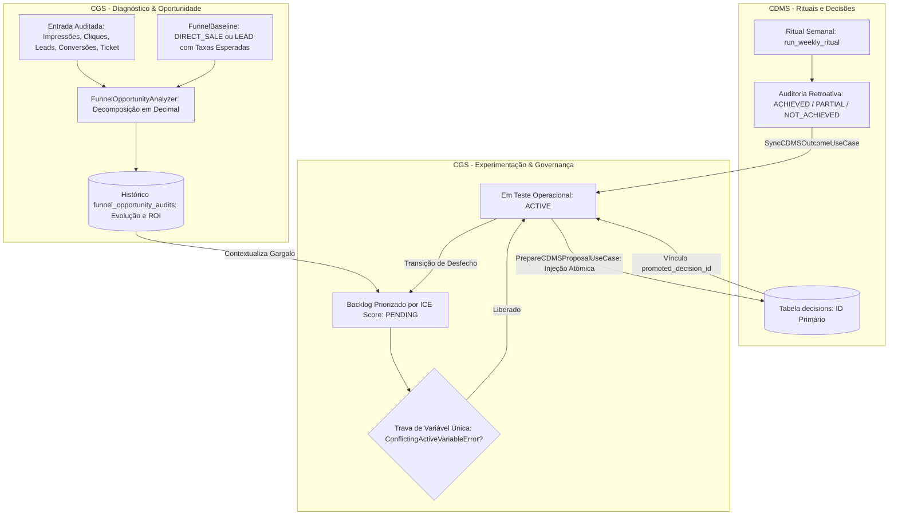

# 📑 SDD — Creator Growth System (CGS)

**Documento:** SDD-CGS-001  
**Versão:** 1.2.0 (Consolidação de Governança Causal, Funil de Dois Passos, Histórico de ROI e Sincronização Bidirecional CDMS)  
**Status:** APROVADO / EM PRODUÇÃO (100% de Sucesso na Suíte de 51 Testes Automatizados)  
**Padrão:** Spec-Driven Development (SDD) com Clean Architecture, Hexagonal (Ports & Adapters) e Monólito Modular  
**Subsistema Alvo:** Pacote `src/cgs` (integrado ao workspace monólito via layout `src/`)  
**Subsistema a Montante:** `cdms` (CDMS v2.3.1 / v2.4.0)  

---

## 1. Visão Geral e Princípios Arquiteturais

O **Creator Growth System (CGS)** opera como o subsistema de **experimentação operacional estruturada**, auditoria de oportunidade de funil e governança de causalidade da operação comercial e de mídia para criadores de conteúdo e gestores de tráfego.

Enquanto o **CDMS** executa a governança de rituais semanais atômicos (mitigação de vaidade, monitoramento de saúde de métricas e calibragem de cenários), o **CGS** fecha o ciclo contínuo de aprendizado e crescimento através de quatro pilares de engenharia:

1. **Auditoria de Oportunidade de Receita (Modelos Direto e 2 Passos):** Avalia a fuga de receita frente a uma baseline comercial calibrada, decompondo gargalos de tráfego (`INTENTION`), captação de leads (`LEAD_CAPTURE`) e fechamento de vendas (`LEAD_CLOSING` / `CONVERSION`), sem inferência espúria de causalidade.
2. **Histórico Acumulado e ROI de Governança:** Consolida a evolução temporal de oportunidades destravadas ou desperdiçadas em reais ($R\$$), permitindo auditar a eficácia das decisões semanais entre ciclos sucessivos.
3. **Máquina de Estados de Hipóteses com Trava de Variável Única:** Gerencia o ciclo de vida operacional (`PENDING` / `BACKLOG` $\rightarrow$ `ACTIVE` $\rightarrow$ `COMPLETED` / `DISCARDED`) e aplica a trava causal com a exceção de domínio `ConflictingActiveVariableError`, impedindo testes concorrentes sobre a mesma variável no mesmo ciclo.
4. **Sincronização Bidirecional Transacional com o CDMS:** Injeta imediatamente a proposta como uma `Decision` vinculada no CDMS e sincroniza retroativamente os vereditos emitidos na auditoria do ritual semanal (`ACHIEVED`, `PARTIAL`, `NOT_ACHIEVED`) diretamente no status final da hipótese no CGS.

### Princípios de Engenharia e Integridade:

* **Precisão Decimal Estrita:** Cálculos de oportunidade e scores utilizam a classe `Decimal` de precisão fixa com arredondamento explícito (`ROUND_HALF_UP`), eliminando resíduos de ponto flutuante (`float`).
* **Qualificação de Oportunidade:** Valores financeiros representam rigorosamente *Oportunidade Estimada de Receita Frente à Referência* (potencial recuperável sob as metas declaradas).
* **Isolamento de Causalidade:** Apenas uma hipótese ativa por variável (`CREATIVE`, `HOOK`, `CTA`, `OFFER`, `LANDING_PAGE`) é admitida por ciclo de execução.
* **Idempotência e Retrocompatibilidade:** Compatibilidade plena com esquemas versionados anteriores (Migrações SQLite 2 e 3) e mapeamento semântico unificado de estados (`BACKLOG` e `PENDING`).



---

## 2. Dicionário Operacional e Fórmulas de Funil

### 2.1. Modalidades de Conversão Comercial

O CGS suporta dois padrões operacionais declarados na baseline ativa (`FunnelBaseline`):

1. **Venda Direta (`ConversionType.DIRECT_SALE`):** O tráfego direciona imediatamente para o checkout ou página de compra direta.
2. **Funil em Dois Passos (`ConversionType.LEAD`):** O tráfego passa por captura de opt-in (Lead) para subsequente fechamento comercial (venda direta).

| Parâmetro | Tipo | Unidade | Descrição Operacional |
| :--- | :--- | :--- | :--- |
| `impressions` | `int` | Exibições | Volume total de visualizações de conteúdo ($\ge 0$). |
| `clicks` | `int` | Eventos | Cliques reais verificados no link/CTA ($\le \text{impressions}$). |
| `leads` | `Optional[int]` | Cadastros | Leads únicos captados (obrigatório em funis `LEAD`, $\le \text{clicks}$). |
| `conversions` | `int` | Vendas | Vendas concluídas ($\le \text{leads}$ em modelo lead; $\le \text{clicks}$ em direto). |
| `ticket_price` | `Decimal` | Reais ($R\$$) | Ticket médio comercial do produto final ($> 0$). |

---

### 2.2. Formulação Matemática das Oportunidades Financeiras

Sejam as frações da baseline ativa:
$$\tau_{\text{ctr\_ref}} = \frac{\text{expected\_ctr\_pct}}{100}, \quad \tau_{\text{click\_lead\_ref}} = \frac{\text{expected\_conversion\_rate\_pct}}{100}, \quad \tau_{\text{lead\_sale\_ref}} = \frac{\text{lead\_to\_sale\_rate\_pct}}{100}$$

#### A. Modelo de Venda Direta (`DIRECT_SALE`)
$$\Delta_{\text{clicks}} = \max\left(0, \, (\text{impressions} \times \tau_{\text{ctr\_ref}}) - \text{clicks}\right)$$
$$\Delta_{\text{sales}} = \max\left(0, \, (\text{clicks} \times \tau_{\text{click\_lead\_ref}}) - \text{conversions}\right)$$

$$\text{Oportunidade}_{\text{intenção}} = \left\lfloor \left( \Delta_{\text{clicks}} \times \tau_{\text{click\_lead\_ref}} \times \text{ticket\_price} \right) + 0.005 \right\rfloor$$
$$\text{Oportunidade}_{\text{conversão}} = \left\lfloor \left( \Delta_{\text{sales}} \times \text{ticket\_price} \right) + 0.005 \right\rfloor$$
$$\text{Oportunidade}_{\text{total}} = \text{Oportunidade}_{\text{intenção}} + \text{Oportunidade}_{\text{conversão}}$$

#### B. Modelo de 2 Passos com Leads (`LEAD`)
Neste formato, a taxa de fechamento efetiva total de um clique esperado até a venda é:
$$\tau_{\text{efetiva}} = \tau_{\text{click\_lead\_ref}} \times \tau_{\text{lead\_sale\_ref}}$$

As perdas operacionais são decompostas nos 3 pontos de atrito:
1. **Intenção (Perda de tráfego qualificado no criativo/CTA):**
   $$\text{Oportunidade}_{\text{intenção}} = \Delta_{\text{clicks}} \times \tau_{\text{efetiva}} \times \text{ticket\_price}$$
2. **Captura de Leads (Perda de conversão na landing page/opt-in):**
   $$\Delta_{\text{leads}} = \max\left(0, \, (\text{clicks} \times \tau_{\text{click\_lead\_ref}}) - \text{leads}\right)$$
   $$\text{Oportunidade}_{\text{captura}} = \Delta_{\text{leads}} \times \tau_{\text{lead\_sale\_ref}} \times \text{ticket\_price}$$
3. **Fechamento Comercial (Perda na equipe de vendas/checkout a partir dos leads captados):**
   $$\Delta_{\text{fechamento}} = \max\left(0, \, (\text{leads} \times \tau_{\text{lead\_sale\_ref}}) - \text{conversions}\right)$$
   $$\text{Oportunidade}_{\text{fechamento}} = \Delta_{\text{fechamento}} \times \text{ticket\_price}$$

$$\text{Oportunidade}_{\text{conversão\_total}} = \text{Oportunidade}_{\text{captura}} + \text{Oportunidade}_{\text{fechamento}}$$
$$\text{Oportunidade}_{\text{total}} = \text{Oportunidade}_{\text{intenção}} + \text{Oportunidade}_{\text{conversão\_total}}$$

---

### 2.3. Heurística Centralizada de Gargalo

A classificação do estágio crítico (`primary_bottleneck`) é determinística:

1. Se $\text{impressions} == 0$: $\implies \mathbf{ATTENTION}$ (exposição zero no ciclo).
2. Se $\text{Oportunidade}_{\text{total}} == 0.00$: $\implies \mathbf{NONE}$ (operação operando estritamente dentro ou acima das metas).
3. Caso existam gaps no modelo `LEAD`, o gargalo principal corresponde ao maior montante entre:
   $$\max\left(\text{Oportunidade}_{\text{intenção}}, \, \text{Oportunidade}_{\text{captura}}, \, \text{Oportunidade}_{\text{fechamento}}\right)$$
   * Se $\text{Oportunidade}_{\text{intenção}}$ for dominante $\implies \mathbf{INTENTION}$
   * Se $\text{Oportunidade}_{\text{captura}}$ for dominante $\implies \mathbf{LEAD\_CAPTURE}$
   * Se $\text{Oportunidade}_{\text{fechamento}}$ for dominante $\implies \mathbf{LEAD\_CLOSING}$
4. No modelo direto, em caso de empate entre intenção e conversão, prevalece a política de proximidade de caixa: $\implies \mathbf{CONVERSION}$.

---

## 3. Modelo de Entidades de Domínio

### 3.1. Enums de Ciclo de Vida e Classificação

```python
from enum import Enum

class FunnelStage(str, Enum):
    NONE = "NONE"                  # Sem gargalo crítico frente à referência
    ATTENTION = "ATTENTION"        # Zero impressões / Exposição nula
    INTENTION = "INTENTION"        # Quebra de CTR / Engajamento com link
    CONVERSION = "CONVERSION"      # Quebra de checkout no modelo direto
    LEAD_CAPTURE = "LEAD_CAPTURE"  # Quebra na captura de opt-in / Landing page
    LEAD_CLOSING = "LEAD_CLOSING"  # Quebra no fechamento do lead em venda

class ConversionType(str, Enum):
    DIRECT_SALE = "DIRECT_SALE"
    LEAD = "LEAD"

class VariableType(str, Enum):
    CREATIVE = "CREATIVE"          # Formato, estética, edição visual
    HOOK = "HOOK"                  # Primeiros 3s / Headline inicial
    CTA = "CTA"                    # Chamada e direcionamento de destino
    OFFER = "OFFER"                # Condição comercial, preço, bônus
    LANDING_PAGE = "LANDING_PAGE"   # Página de destino, formulário, velocidade

class MetricDirection(str, Enum):
    HIGHER_IS_BETTER = "HIGHER_IS_BETTER"
    LOWER_IS_BETTER = "LOWER_IS_BETTER"

class HypothesisStatus(str, Enum):
    BACKLOG = "BACKLOG"            # Alias/Legado para PENDING
    PENDING = "PENDING"            # Priorizada no backlog aguardando teste
    PROPOSED = "PROPOSED"          # Minuta pré-formatada para ritual
    ACTIVE = "ACTIVE"              # Em execução operacional no ciclo
    COMPLETED = "COMPLETED"        # Concluída e auditada com sucesso/aprendizado
    DISCARDED = "DISCARDED"        # Rejeitada, invalidada ou não atingida
    CANCELLED = "CANCELLED"        # Cancelamento preventivo
    ARCHIVED = "ARCHIVED"          # Arquivo histórico
```

### 3.2. Trava de Governança Causal (`ConflictingActiveVariableError`)

```python
class ConflictingActiveVariableError(ValueError):
    """Disparada ao tentar ativar teste concorrente para a mesma variável no mesmo ciclo."""

    def __init__(self, variable: VariableType, target_cycle_id: Optional[str], active_hypothesis_id: Optional[int] = None):
        cycle_label = target_cycle_id if target_cycle_id else "ciclo corrente"
        hypo_ref = f" (Hipótese #{active_hypothesis_id})" if active_hypothesis_id is not None else ""
        msg = (
            f"Violação da Regra de Variável Única: já existe teste ativo{hypo_ref} "
            f"para a variável '{variable.value}' no ciclo '{cycle_label}'. "
            "Conclua ou descarte o teste concorrente antes de ativar uma nova hipótese para mitigar ruído causal."
        )
        super().__init__(msg)
        self.variable = variable
        self.target_cycle_id = target_cycle_id
        self.active_hypothesis_id = active_hypothesis_id
```

### 3.3. Entidades Ricas: `FunnelBaseline`, `FunnelOpportunityAudit` e `GrowthHypothesis`

```python
@dataclass(frozen=True)
class FunnelBaseline:
    ticket_price: Decimal
    expected_ctr_pct: Decimal
    expected_conversion_rate_pct: Decimal
    conversion_type: ConversionType = ConversionType.DIRECT_SALE
    lead_to_sale_rate_pct: Optional[Decimal] = None
    is_active: bool = True

@dataclass(frozen=True)
class FunnelOpportunityAudit:
    source_cycle_id: str
    primary_bottleneck: FunnelStage
    intention_opportunity_reais: Decimal
    conversion_opportunity_reais: Decimal
    total_opportunity_reais: Decimal
    diagnosis_summary: str
    calculation_version: str = "2.0.0"
    leads_opportunity_reais: Optional[Decimal] = None
    closing_opportunity_reais: Optional[Decimal] = None

@dataclass
class GrowthHypothesis:
    id: Optional[int]
    source_cycle_id: Optional[str]
    target_cycle_id: Optional[str]
    promoted_decision_id: Optional[int]
    action_description: str
    tested_variable: VariableType
    target_metric_key: str
    target_metric_unit: str
    metric_direction: MetricDirection
    baseline_reference_value: Decimal
    success_metric_target: Decimal
    invalidation_floor: Decimal
    expected_impact_description: str
    impact_score: int
    confidence_score: int
    ease_score: int
    sample_exposure_minimum: int = 100
    window_days: int = 7
    status: HypothesisStatus = HypothesisStatus.PENDING
    created_at: datetime = field(default_factory=lambda: datetime.now(timezone.utc))

    @property
    def ice_score(self) -> Decimal:
        raw = (Decimal(self.impact_score) * Decimal(self.confidence_score) * Decimal(self.ease_score)) / Decimal("10")
        return raw.quantize(Decimal("0.01"))

    def activate(self, target_cycle_id: Optional[str] = None, promoted_decision_id: Optional[int] = None) -> None:
        if self.status not in (HypothesisStatus.PENDING, HypothesisStatus.BACKLOG, HypothesisStatus.PROPOSED):
            raise ValueError(f"Apenas hipóteses PENDING podem ser ativadas. Status atual: {self.status.value}")
        self.status = HypothesisStatus.ACTIVE
        if target_cycle_id:
            self.target_cycle_id = target_cycle_id
        if promoted_decision_id:
            self.promoted_decision_id = promoted_decision_id

    def complete(self) -> None:
        if self.status != HypothesisStatus.ACTIVE:
            raise ValueError(f"Apenas hipóteses ACTIVE podem ser concluídas. Status atual: {self.status.value}")
        self.status = HypothesisStatus.COMPLETED

    def discard(self) -> None:
        if self.status in (HypothesisStatus.COMPLETED, HypothesisStatus.DISCARDED, HypothesisStatus.ARCHIVED):
            raise ValueError(f"Hipótese já encerrada com status {self.status.value}.")
        self.status = HypothesisStatus.DISCARDED
```

---

## 4. Contratos de Porta e Casos de Uso

### 4.1. Porta de Persistência (`GrowthRepositoryPort`)

A interface dirigida declara formalmente as operações necessárias para governança:

* `save_baseline` / `get_active_baseline`
* `save_funnel_audit` / `get_funnel_audit` / `list_funnel_audits(limit: int = 50)`
* `save_hypothesis` / `get_hypothesis_by_id` / `get_hypothesis_by_decision_id(decision_id: int)`
* `list_hypotheses(status: Optional[HypothesisStatus] = None, limit: int = 50)`
* `get_active_hypothesis_by_variable(tested_variable: VariableType, target_cycle_id: Optional[str] = None)`
* `update_hypothesis_status(hypothesis_id: int, status: Union[HypothesisStatus, str], target_cycle_id: Optional[str] = None, promoted_decision_id: Optional[int] = None)`

### 4.2. Preparação de Proposta e Promoção Atômica (`PrepareCDMSProposalUseCase`)

Ao acionar a formalização da proposta para o ritual semanal:
1. Valida se a hipótese está em estado apto (`PENDING` ou `ACTIVE`).
2. Verifica preventivamente se já existe hipótese ativa com a mesma variável no ciclo alvo, disparando `ConflictingActiveVariableError`.
3. Injeta e persiste de imediato uma entidade `Decision` no banco de dados do CDMS, recuperando seu `promoted_decision_id`.
4. Transiciona a hipótese no CGS para `ACTIVE`, gravando o vínculo transacional e gerando o parecer formal em Markdown.

### 4.3. Sincronização de Vereditos CDMS $\rightarrow$ CGS (`SyncCDMSOutcomeUseCase`)

Ao auditar decisões retroativas no ritual semanal do CDMS:
* `ACHIEVED` ou `PARTIAL`: Transiciona a hipótese vinculada para `COMPLETED`.
* `NOT_ACHIEVED`: Transiciona a hipótese vinculada para `DISCARDED`.
* Garante idempotência: registros em estados terminais não sofrem transições espúrias.

---

## 5. Esquema de Banco de Dados SQLite (Versões de Esquema 2 e 3)

O repositório `SQLiteGrowthRepository` implementa o versionamento incremental idempotente:

```sql
-- Migração 002: Tabelas Base do CGS
CREATE TABLE IF NOT EXISTS growth_baselines (
    id INTEGER PRIMARY KEY AUTOINCREMENT,
    ticket_price TEXT NOT NULL,
    expected_ctr_pct TEXT NOT NULL,
    expected_conversion_rate_pct TEXT NOT NULL,
    conversion_type TEXT NOT NULL DEFAULT 'DIRECT_SALE',
    lead_to_sale_rate_pct TEXT,
    is_active INTEGER NOT NULL DEFAULT 1,
    created_at TEXT NOT NULL
);

CREATE TABLE IF NOT EXISTS funnel_opportunity_audits (
    id INTEGER PRIMARY KEY AUTOINCREMENT,
    source_cycle_id TEXT NOT NULL,
    primary_bottleneck TEXT NOT NULL,
    intention_opportunity_reais TEXT NOT NULL,
    conversion_opportunity_reais TEXT NOT NULL,
    total_opportunity_reais TEXT NOT NULL,
    diagnosis_summary TEXT NOT NULL,
    calculation_version TEXT NOT NULL,
    calculated_at TEXT NOT NULL
);

CREATE TABLE IF NOT EXISTS growth_hypotheses (
    id INTEGER PRIMARY KEY AUTOINCREMENT,
    source_cycle_id TEXT,
    target_cycle_id TEXT,
    promoted_decision_id INTEGER,
    action_description TEXT NOT NULL,
    tested_variable TEXT NOT NULL,
    target_metric_key TEXT NOT NULL,
    target_metric_unit TEXT NOT NULL,
    metric_direction TEXT NOT NULL,
    baseline_reference_value TEXT NOT NULL,
    success_metric_target TEXT NOT NULL,
    invalidation_floor TEXT NOT NULL,
    expected_impact_description TEXT NOT NULL,
    impact_score INTEGER NOT NULL,
    confidence_score INTEGER NOT NULL,
    ease_score INTEGER NOT NULL,
    ice_score TEXT NOT NULL,
    sample_exposure_minimum INTEGER NOT NULL DEFAULT 100,
    window_days INTEGER NOT NULL DEFAULT 7,
    status TEXT NOT NULL DEFAULT 'PENDING',
    created_at TEXT NOT NULL
);

-- Migração 003: Índices de Governança Causal e Suporte a Funil de 2 Passos
ALTER TABLE funnel_opportunity_audits ADD COLUMN leads_opportunity_reais TEXT;
ALTER TABLE funnel_opportunity_audits ADD COLUMN closing_opportunity_reais TEXT;

CREATE INDEX IF NOT EXISTS idx_cgs_hypotheses_ranking 
ON growth_hypotheses(status, ice_score DESC, created_at ASC);

CREATE INDEX IF NOT EXISTS idx_cgs_hypotheses_active_var 
ON growth_hypotheses(status, tested_variable, target_cycle_id);

CREATE INDEX IF NOT EXISTS idx_cgs_hypotheses_decision 
ON growth_hypotheses(promoted_decision_id);

CREATE INDEX IF NOT EXISTS idx_cgs_audits_source_cycle 
ON funnel_opportunity_audits(source_cycle_id);

CREATE INDEX IF NOT EXISTS idx_cgs_baselines_active 
ON growth_baselines(is_active);
```

---

## 6. Cobertura da Suíte de Testes Automatizados (51/51 Aprovados)

A suíte executada via `pytest` no ambiente de desenvolvimento registrou aprovação de 100% de seus testes:

| Domínio de Teste | Arquivo de Teste | Qtd | Status |
| :--- | :--- | :--- | :--- |
| **Integração: Ciclo de Vida e Sincronização** | `tests/integration/test_lifecycle_and_sync.py` | 4 | **PASSED** |
| **Integração: Persistência SQLite CGS** | `tests/integration/test_sqlite_growth_repo.py` | 7 | **PASSED** |
| **Integração: Transacionalidade CDMS Core** | `tests/integration/test_sqlite_repo.py` | 2 | **PASSED** |
| **Unitário: Diagnóstico de Cenários (81 Combinações)** | `tests/unit/test_diagnose_scenario.py` | 3 | **PASSED** |
| **Unitário: Analisador de Funil e Validações** | `tests/unit/test_funnel_analyzer.py` | 11 | **PASSED** |
| **Unitário: Entidade Hipótese e ICE Score** | `tests/unit/test_growth_hypothesis.py` | 15 | **PASSED** |
| **Unitário: Métricas e Desvios de Snapshots** | `tests/unit/test_metrics.py` | 6 | **PASSED** |
| **Unitário: Orquestração de Rituais Semanais** | `tests/unit/test_run_weekly_ritual.py` | 3 | **PASSED** |
| **TOTAL CONSOLIDADO** | — | **51** | **100% SUCESSO** |

---

## 7. Critérios de Homologação em Produção

1. **Garantia de Não-Interferência:** A integridade de dados do CDMS original permanece inviolável; nenhuma hipótese ativa força escritas sem prévia geração formal de `Decision`.
2. **Materialização de ROI na UI:** A página `growth_engine_page.py` apresenta na Aba 1 a evolução de redução de perdas financeiras entre ciclos sucessivos e o histórico cumulativo em tabela e gráfico de barras empilhadas.
3. **Resiliência Multiplataforma:** O adaptador de persistência SQLite implementa rotinas tolerantes a travamento de conexões (*file locks* no Windows), garantindo coleta de lixo sem retenção indevida de arquivos temporários.
4. **Fechamento Completo do Ciclo de Aprendizado:** Nenhuma hipótese permanece no estado `ACTIVE` indefinidamente; a conclusão ou auditoria no ritual do CDMS fecha o ciclo automaticamente com `COMPLETED` ou `DISCARDED`.