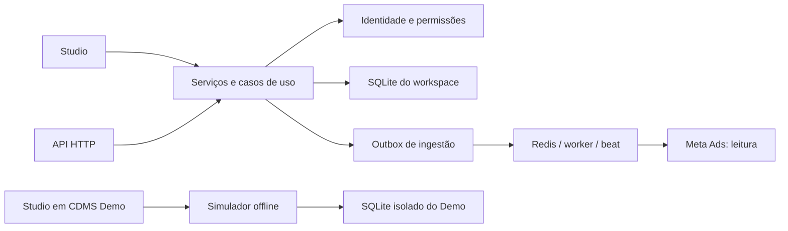

# SDD-STUDIO-001 — Studio integrado, experimentos e Demo

**Versão:** 1.0.0

**Data de referência:** 2026-10-31

**Status:** contratos implementados no repositório; não constitui declaração de publicação ou homologação com conta Meta real.

## 1. Escopo e precedência

Este documento consolida os fluxos atuais de interface, identidade, orçamento,
avaliação A/B, importação Meta e Demo 2.0. Para esses temas, prevalece sobre
exemplos e propostas dos SDDs históricos CDMS 2.4.0, CGS 1.2.0 e CDMS-PHASE2.
As regras de classificação e do ritual permanecem nos documentos de domínio.
As versões do SDD, do pacote Demo e do algoritmo são independentes.

Guias operacionais: [login](etapa-13-login-studio.md),
[usuários](gestao-de-usuarios.md), [experimentos e Meta](orcamento-ab-importacao-meta.md).

## 2. Arquitetura e armazenamento

- Studio e API chamam serviços/casos de uso compartilhados. O Studio não depende
  de chamadas HTTP à própria API para executar os fluxos.
- Identidade central em `identity.db`: usuários, senhas protegidas e vínculos.
  Os dados operacionais são armazenados em um SQLite por UUID de workspace,
  escolhido pelo servidor após autenticação. O banco local legado é separado.
- A ingestão real usa outbox SQLite, Redis, Celery worker e beat. A configuração
  da conexão não comprova disponibilidade desses processos.
- O Demo usa `data/demo/<sessão UUID>/<geração UUID>.db`, relativo ao DATA_DIR
  configurado. Cada carregamento/restauração publica uma geração nova somente
  depois da preparação dos dados. Bancos anteriores não são sobrescritos.



## 3. Navegação e evidências

| Área | Responsabilidade |
|---|---|
| Cockpit | Diagnóstico, decisão, investimento, últimas avaliações e importações do ciclo. |
| Governança | Ritual, histórico, exportação e calibrações. |
| Experimentos | Funil, hipóteses, orçamento, avaliação A/B, baseline e relatório. |
| Configurações | Usuários e integrações para gestores; no Demo, apenas integrações fictícias. |

Workspace/ciclo ficam no painel lateral; no celular, no menu Seções.
Minha conta fica à direita do cabeçalho e contém nome/perfil, email, tema,
troca de senha e saída. Os temas claro/escuro são preferências da conta;
componentes nativos em canvas podem manter o tema do servidor.

O inspector Evidências começa fechado. Abre como card não modal à direita e
fecha pelo botão X ou pelo controle Evidências. Mantém a largura da área
principal e usa rolagem própria. No celular, abre o mesmo conteúdo contextual.
Formulários de edição permanecem na área principal.

O contexto usa o ciclo selecionado, o ciclo do ritual/relatório quando aplicável
e a hipótese selecionada em orçamento/A-B ou pelo botão Ver evidências do backlog.
As consultas sempre usam o banco atual. Uma seleção de outro workspace ou de
um ciclo incompatível não deve reaproveitar dados anteriores. O painel mostra
somente valores salvos: orçamento, avaliação, diagnóstico, decisão e origem Meta.
Rascunhos financeiros são preservados ao abrir/fechar e separados por contexto;
a troca de workspace autenticado limpa a sessão.

## 4. Identidade e autorização

| Perfil | Operações |
|---|---|
| VIEWER | Consulta dados, orçamento, avaliações e importações. |
| MEMBER | Também opera experimentos, registra gastos e solicita/revisa importações. |
| ADMIN | Também gerencia membros comuns, conexões e teto do ciclo. |
| OWNER | Também nomeia/gerencia administradores; seu vínculo é protegido. |

Cadastro de contas novas usa senha temporária com troca obrigatória antes do
acesso operacional. Contas existentes adicionadas ao workspace mantêm senha e
nome. Alteração/redefinição de senha revoga sessões. A redefinição por gestor
não pode assumir contas compartilhadas com outros workspaces. Não há envio
automático de convites ou recuperação pública por email.

O modo local é uma configuração explícita do servidor, não um fallback de login.
Nele o operador pode usar dados locais e Demo sem simular identidade de produção.

## 5. Orçamento por hipótese/ciclo

- Identificador do ciclo: segunda-feira em `YYYY-MM-DD`.
- Valores em BRL e centavos inteiros, com validação de finitude e precisão.
- Teto inicial: R$ 5.000 por ciclo; alteração por OWNER/ADMIN, ou operador local.
  Não pode ser reduzido abaixo do já comprometido.
- Verificação do teto e gravação da alocação ocorrem na mesma transação.
- A chave da alocação é hipótese + ciclo. A hipótese deve existir no banco atual
  e, quando tiver ciclo alvo definido, ser compatível com o ciclo solicitado.
- Editar alocação preserva gasto acumulado e data inicial. Hipóteses encerradas
  não recebem novas alocações, mas podem receber registro de gasto realizado.
- Gasto acumulado não diminui. Excesso real sobre o alocado é registrado e gera
  alerta. Registrar gasto não movimenta dinheiro nem altera campanhas.
- Alterações mantêm autor, data e conteúdo no histórico.

Tabelas: `experiment_budgets`, `experiment_cycle_limits`,
`experiment_budget_events`. Não há importação das antigas tabelas de orçamento.

## 6. Avaliação A/B

Entradas: hipótese, ciclo semanal, definição do evento/unidade de exposição,
amostras e conversões de controle/tratamento e amostra mínima por grupo.
Contagens são inteiras; amostras positivas; conversões entre zero e amostra.
O usuário deve conferir mesma métrica, janela e separação dos grupos.

Modelo implementado: posterior independente Beta(conversões + 1,
amostra - conversões + 1), prior Beta(1,1), com 30.000 simulações reproduzíveis.
Saídas: probabilidade de ganho, lift observado, intervalo de credibilidade de
95% da diferença em pontos percentuais, cobertura de amostra e indicação
operacional. O método é versionado como `beta-binomial-mc-v1`.

O piso de amostra vale para ambos os grupos e é verificado antes do arredondamento.
O limiar padrão de ganho é 95%. Antes de metade da amostra mínima, o resultado
é inconclusivo. Com pelo menos metade em ambos os grupos, perda observada maior
que 30% e probabilidade de ganho até 5% indicam considerar interrupção; isso não
executa uma pausa externa. Sem amostra completa, os demais casos são inconclusivos.
Lift relativo é indefinido quando a taxa observada do controle é zero.

Cada avaliação gera um registro imutável em `experiment_evaluations`, com
entradas, ciclo, evento, método, parâmetros, resultado, autor e data. Não importa
avaliações antigas calculadas pela aproximação normal. A avaliação não altera
automaticamente o estado da hipótese nem substitui a auditoria no ritual.
Probabilidade posterior depende do modelo e do desenho experimental; não
comprova causalidade isoladamente.

## 7. Integração Meta real

OWNER/ADMIN cadastram e validam conta, token de leitura, evento e versão de API.
Credenciais usam Fernet com `CDMS_CREDENTIAL_KEY`, separada da chave JWT.
Não são devolvidas nas listas. Recadastro atualiza a revisão e pode invalidar
jobs antigos da conexão. Desativação local não revoga o token na Meta.

Coletas reais exigem semana completa encerrada no fuso da conta. Jobs seguem
PENDING → RUNNING → SUCCESS/FAILED, com lease, retentativas limitadas e outbox
durável. Ausência de broker não apaga a solicitação. Nova geração preserva batches
anteriores. O worker revalida acesso e revisão da conexão.

Após SUCCESS, o usuário revisa período, origem, métricas e indisponibilidades.
O aceite registra job, ciclo, revisor e data em `ritual_metric_sources` e preenche
somente o rascunho. Rituais concluídos não são sobrescritos. O valor final pode
ser ajustado pelo usuário; o vínculo de origem não afirma igualdade automática
entre batch e ritual fechado.

Retenção média fica indisponível no adaptador. Moeda/gasto não são convertidos
implicitamente para BRL. Agregados de conta/semana não alimentam automaticamente
grupos A/B nem o gasto de uma hipótese. Não há OAuth/renovação automática.

## 8. Demo 2.0

Conteúdo inicial de cada pacote:

| Conteúdo | Quantidade |
|---|---:|
| Ciclos históricos / diagnósticos | 12 / 12 |
| Hipóteses / aprendizados auditados | 18 / 11 |
| Orçamentos / avaliações A/B | 13 / 13 |
| Contas fictícias / coletas simuladas | 3 / 15 |

Os exemplos incluem ganho, perda, amostra insuficiente e gasto acima da alocação.
Um ciclo adicional de prática, ainda sem ritual encerrado no pacote inicial,
contém orçamento, avaliação e coletas SUCCESS, FAILED e PENDING em contas
distintas. Permite concluir pendência, repetir falha, gerar nova versão e importar
para rascunho. A/B usa amostras didáticas próprias, não os agregados Meta.

O simulador nunca instancia conector real, cofre de credenciais ou dispatcher.
Só aceita arquivos UUID dentro da raiz Demo. Pode simular a semana atual,
exceção que não vale para a ingestão real. A UI identifica os dados como simulados
e não pede token. Restaurar cria uma geração nova e limpa os rascunhos do Demo,
preservando os dados locais e de workspaces. Pacotes 1.0 precisam ser recarregados.
Cobertura completa mantém o catálogo de 81 combinações + 4 indisponibilidades.

## 9. Contratos HTTP do recorte

Autenticação Bearer e seleção do banco pelo tenant validado são obrigatórias.

| Método / caminho sob `/api/v1` | Contrato |
|---|---|
| POST `/growth-v2/allocate-budget` | Hipótese, ciclo, valor, risco e CPA opcional. |
| PUT `/growth-v2/cycles/{cycle_id}/limit` | Teto em `amount_reais`, exige gestor. |
| PUT `/growth-v2/budgets/{hypothesis_id}/cycles/{cycle_id}/spend` | Gasto acumulado em `amount_reais`. |
| GET `/growth-v2/cycles/{cycle_id}/budget` | Teto, alocações e histórico. |
| POST `/growth-v2/evaluate-statistical-significance` | Inclui `cycle_id`; `lift_pct` pode ser nulo. |
| GET `/growth-v2/evaluations/{hypothesis_id}/history` | Histórico, com filtro opcional por ciclo. |
| POST `/automation/connect-platform` | Conexão real Meta, exige gestor. |
| POST `/automation/connections/{connection_id}/sync` | Coleta, retentativa ou nova geração. |
| GET `/automation/jobs/{job_id}/result` | Batch concluído, sem credenciais. |

O Demo offline é uma capacidade da UI local; não transforma esses endpoints
de produção em endpoints de simulação. Os demais contratos constam no OpenAPI
gerado pela aplicação e nos guias operacionais.

## 10. Aceite e limites

Testes devem verificar: isolamento entre workspaces e Demo/Local; ausência de
rede/Redis/credenciais no simulador; teto sob concorrência; preservação de gastos;
histórico A/B reconstituível; validação das contagens e dos dois grupos; controle
de permissões; idempotência e falha de broker; rascunhos ao abrir/fechar Evidências;
troca correta de contexto; origem revisada e proteção de rituais encerrados;
restauração do Demo em nova geração.

Testes automatizados não equivalem a homologação visual em todos os dispositivos
ou a validação com uma conta Meta real. Para reproduzir:

```powershell
.\.venv\Scripts\python.exe -m pytest -q
```

Permanecem fora deste recorte: execução/rollback real de tráfego, novos conectores
YouTube/TikTok, sugestões via LLM, integração do índice de saúde ao Studio,
recuperação pública por email e implantação em PostgreSQL/nuvem.
