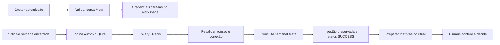

# Etapa 5 — Meta Ads e ingestão automatizada por workspace

## Escopo

Primeiro adaptador real: Meta Ads, priorizado pelo usuário. O código faz requisições HTTP de leitura à Marketing API. YouTube e TikTok retornam 501; os conectores simulados anteriores permanecem apenas para testes existentes.

Não foram usados tokens ou contas externas reais na validação. Os contratos HTTP são exercitados com respostas controladas, e o transporte Celery é testado com workers reais em memória e Redis.

## Fluxo



Jobs e ingestões usam o mesmo banco operacional do workspace da etapa 4. A migração 008 cria tabelas próprias de conexões, jobs e batches; não usa as tabelas com referências à identidade central da antiga migração 005.

## Configuração

Instale as dependências:

```powershell
.\.venv\Scripts\python.exe -m pip install -e ".[dev,api,automation]"
```

Mantenha `CDMS_SECRET_KEY` da etapa 4. Gere uma chave Fernet uma vez e guarde-a de forma protegida para API e workers:

```powershell
$env:CDMS_CREDENTIAL_KEY = & .\.venv\Scripts\python.exe -c "from cryptography.fernet import Fernet; print(Fernet.generate_key().decode())"
$env:CDMS_REDIS_URL = "redis://127.0.0.1:6381/0"
```

Não gere uma nova chave Fernet a cada inicialização: isso impediria a leitura das credenciais anteriores. A chave não é gravada no banco nem no Git. Alterar a chave JWT não altera a criptografia das conexões.

Inicie o Redis dedicado ao CDMS:

```powershell
docker compose -f compose.automation.yml up -d --wait
```

Ele escuta apenas em `127.0.0.1:6381`, usa volume próprio e não substitui serviços Docker existentes.

Em terminais com o mesmo ambiente configurado:

```powershell
# API: 8001 evita a porta 8000 já usada por outro serviço local.
.\.venv\Scripts\python.exe -m uvicorn cdms.adapters.api.main:app --port 8001

# Worker de desenvolvimento com pool solo.
.\.venv\Scripts\python.exe -m celery -A cdms.adapters.tasks.celery_app:celery_app worker --pool=solo --loglevel=INFO

# Agendador: mantenha apenas uma instância.
.\.venv\Scripts\python.exe -m celery -A cdms.adapters.tasks.celery_app:celery_app beat --loglevel=INFO --schedule data/celerybeat-schedule
```

Se usar caminhos diferentes, configure igualmente na API, worker, agendador e provisionamento:

- `CDMS_IDENTITY_DB_PATH`: padrão `data/identity.db`.
- `CDMS_WORKSPACE_DATA_DIR`: padrão `data/workspaces`.
- `CDMS_META_API_VERSION`: padrão `v26.0`, configurável na conexão.

Os caminhos padrão são resolvidos a partir do projeto. Caminhos personalizados relativos dependem do diretório de execução; prefira caminhos absolutos nesses casos.

## Conectar e sincronizar

Faça login na API pelo `/docs`, usando o usuário/workspace provisionados na etapa 4. O cadastro e a desativação de conexões exigem OWNER ou ADMIN. MEMBER também pode solicitar sincronizações; VIEWER apenas consulta dados.

`POST /api/v1/automation/connect-platform`:

```json
{
  "platform": "META_ADS",
  "account_id": "act_123456789",
  "access_token": "TOKEN_DA_META",
  "api_version": "v26.0",
  "conversion_action_type": "offsite_conversion.fb_pixel_purchase",
  "automatic_sync": false
}
```

O token deve ter acesso de leitura à conta e aos Insights. Não cole credenciais no chat nem no repositório. Se o aplicativo Meta exigir app secret proof, envie também `app_secret`; ele é cifrado junto ao token e o adaptador calcula a prova HMAC. Este fluxo recebe credenciais já obtidas na Meta; não implementa tela de consentimento OAuth ou renovação automática de tokens.

O cadastro confirma acesso aos metadados da conta, moeda e fuso. A coleta posterior também depende das permissões de Insights. Recadastrar a mesma conta atualiza a configuração, cifra as novas credenciais e aumenta sua revisão; jobs antigos pendentes deixam de usar aquela conexão. Desativar localmente não revoga o token na plataforma Meta.

Escolha o evento correspondente ao objetivo de negócio: o exemplo conta somente compras do pixel. Para leads, configure o evento de lead apropriado. O adaptador não soma categorias sobrepostas de compra para evitar duplicações.

`POST /api/v1/automation/connections/{connection_id}/sync`:

```json
{"cycle_id": "2026-10-19"}
```

O ciclo deve ser uma segunda-feira cuja semana completa, de segunda a domingo, já tenha terminado no fuso da conta.

A API retorna 202 com `job` e `dispatch_status`:

- `ENQUEUED`: a publicação na fila foi solicitada com sucesso.
- `DEFERRED`: o broker estava indisponível; o job permanece na outbox para recuperação.
- `EXISTING`: já existe solicitação para a mesma conexão/revisão/semana; não foi criada uma duplicata.

Consulte `/automation/jobs/{job_id}`. Após SUCCESS, `/result` retorna os dados e `/ritual-input` retorna `week_start` e as quatro entradas de métricas para o ritual. Complete a decisão e envie o payload revisado a `POST /api/v1/rituals`.

`retry_failed: true` reabre um job FAILED para uma nova tentativa manual. `force_refresh: true` cria uma nova geração após um resultado terminal, preservando o batch anterior para auditoria. Os dois parâmetros não podem ser usados juntos. Uma nova coleta nunca sobrescreve um ritual já encerrado.

## Significado das métricas

| Campo | Tratamento |
|---|---|
| Alcance | Agregado único da conta no período semanal; não soma alcances diários ou de campanhas. |
| Impressões | Valor retornado no agregado semanal. |
| Cliques e CTR | Usa `inline_link_clicks`; CTR calculado sobre impressões, em percentual. |
| Conversões | Valor de um único `conversion_action_type`, sob a atribuição configurada na conta Meta. Não é soma de todos os tipos de ação. |
| Retenção média | Indisponível (`NOT_SUPPORTED`) neste adaptador; não é estimada por outra métrica. |
| Gasto | Decimal em texto e moeda da conta, sem conversão implícita para reais. |

Resposta vazia gera valores indisponíveis, não zeros fabricados. Campos não retornados permanecem indisponíveis. Com zero impressões, CTR fica indisponível. Um array de ações retornado sem o evento escolhido corresponde a zero desse evento. Campos de contagem fracionários ou inválidos são rejeitados em vez de arredondados silenciosamente.

O relatório guarda versão da API, evento, definição de clique, período, fuso e moeda. Não guarda tokens, URLs de paginação ou mensagens brutas da plataforma. Os dados de auditoria consistem em uma seleção de campos permitidos, não em uma cópia irrestrita da resposta HTTP.

## Execução e recuperação

- Cada publicação transporta somente UUID do workspace e ID do job.
- O worker valida o workspace e revalida o solicitante antes e depois da chamada externa.
- Jobs seguem PENDING → RUNNING → SUCCESS ou FAILED. Falhas transitórias podem voltar a PENDING, com limite de três execuções por rodada.
- A execução possui lease de cinco minutos e um token de posse. Um worker antigo não pode concluir ou alterar um job assumido por outro worker.
- Um dispatcher periódico procura jobs pendentes e leases expirados a cada minuto. A indisponibilidade do Redis não apaga a solicitação.
- Falhas de autenticação/permissão da plataforma não são repetidas automaticamente. Corrija a conexão antes de nova tentativa.
- `automatic_sync: true` habilita o planejamento da última semana encerrada. A varredura ocorre a cada hora, no minuto 5; solicitações repetidas são deduplicadas. Só conexões ativas cujo responsável ainda tem acesso de escrita participam.

A automação prepara dados; a decisão e o fechamento do ritual continuam explícitos. Um diagnóstico pode permanecer inconclusivo se uma métrica canônica estiver indisponível.

## Testes

```powershell
$env:CDMS_TEST_REDIS_URL = "redis://127.0.0.1:6381/15"
.\.venv\Scripts\python.exe -m pytest -q
```

A URL de testes deve apontar a um Redis de desenvolvimento. Os testes usam filas com nomes únicos e removem seus próprios resultados; não fazem flush do servidor. Sem essa variável, somente o caso de transporte Redis é ignorado; o worker em memória continua sendo executado.

Os testes da API usam bancos temporários e hashes de custo reduzido para fixtures de autorização. A política real de senhas, PBKDF2-SHA256 com 600.000 iterações, é verificada separadamente.

## Referências de implementação

- [SDK oficial Meta — versão da API](https://github.com/facebook/facebook-python-business-sdk/blob/main/facebook_business/apiconfig.py).
- [SDK oficial Meta — parâmetros de Insights](https://github.com/facebook/facebook-python-business-sdk/blob/main/facebook_business/adobjects/adaccount.py).
- [SDK oficial Meta — campos de Insights](https://github.com/facebook/facebook-python-business-sdk/blob/main/facebook_business/adobjects/adsinsights.py).
- [SDK oficial Meta — app secret proof](https://github.com/facebook/facebook-python-business-sdk/blob/main/facebook_business/session.py).
- [Celery — idempotência, timeouts e retentativas](https://docs.celeryq.dev/en/stable/userguide/tasks.html).
- [Fernet — criptografia de credenciais](https://cryptography.io/en/latest/fernet/).

A leitura direta da documentação web da Meta foi limitada por HTTP 429 durante a análise; os contratos foram conferidos no SDK oficial da própria Meta. A validação final com conta real depende de credenciais e permissões configuradas pelo proprietário.


## Resultado registrado em 2026-10-28

- **168 testes aprovados**, sem exclusões, com `CDMS_TEST_REDIS_URL` configurada.
- Foram executados 22 casos do adaptador Meta e 22 cenários de ingestão, incluindo workers Celery reais com fila em memória e Redis em `127.0.0.1:6381`.
- Os testes anteriores de workspace, interface, domínio e persistência continuaram passando.
- `pip check` não encontrou dependências quebradas, e a revisão de espaços das alterações passou.
- O wheel foi construído e conferido, incluindo schema, migração 008, adaptador e runtime.
- O SHA-256 do banco local permaneceu igual antes e depois desta etapa.
- A suíte emitiu 41 avisos de depreciação internos: Starlette/HTTPX, Celery/Redis e Streamlit/pandas. Não houve falhas.

O Redis de desenvolvimento foi iniciado para esta validação e permanece disponível. Para pará-lo sem remover o volume:

```powershell
docker compose -f compose.automation.yml stop redis
```

Nenhuma conexão real ou token do proprietário foi cadastrado. A homologação da leitura da conta Meta ainda exige configuração local das credenciais e permissões pelo proprietário.
