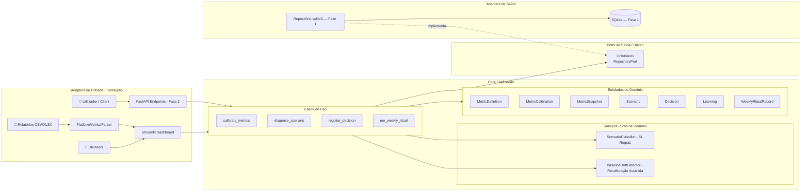
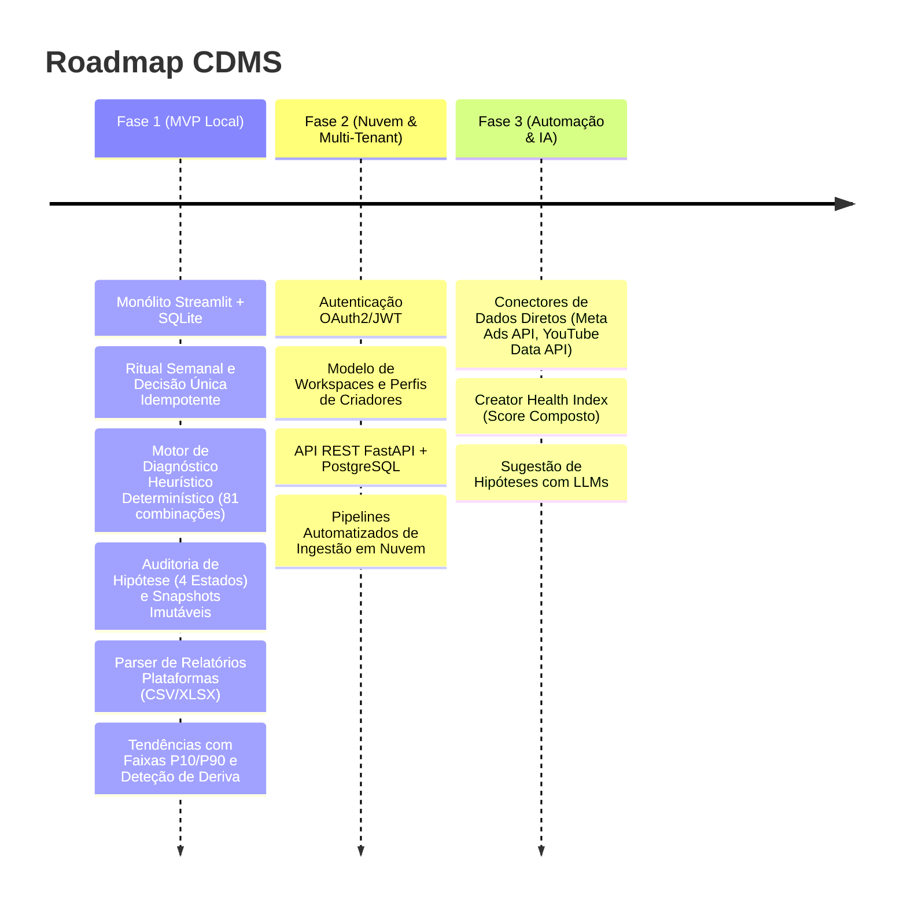

# 📑 SDD — Creator Data Marketing System (CDMS)

**Versão:** 2.4.0 (Ingestão de Mídia, Tendências Históricas e Recalibração Assistida)  
**Padrão:** Spec-Driven Development (SDD) com Clean Architecture, Hexagonal (Ports & Adapters) e Monólito Modular  
**Layout de Empacotamento:** Python `src/` layout (PEP 517/621 via `pyproject.toml`)

---

## 1. Visão Geral e Princípios Arquiteturais

O **Creator Data Marketing System (CDMS)** é uma plataforma voltada à tomada de decisão data-driven para criadores de conteúdo e gestores de tráfego/mídia. O foco do sistema é o **Ritual Semanal**: transformar dados dispersos em calibração de métricas, diagnóstico heurístico de momento operacional (sinais de alerta e tração) e o compromisso formal com uma **Decisão Única por Ciclo**, estabelecendo um circuito fechado de auditoria de hipóteses.

### Princípios de Engenharia:
* **Core Isolado e Agnóstico:** O domínio de regras puras e entidades não possui dependências de frameworks de infraestrutura (FastAPI, Streamlit, SQLAlchemy, Pydantic).
* **Imutabilidade Histórica:** As observações e diagnósticos do passado registram a calibração de faixas vigentes no momento do ritual. Alterações futuras nas metas não reescrevem o histórico.
* **Governança por Idempotência:** Cada ciclo semanal possui identificador canônico unívoco (`cycle_id = YYYY-MM-DD` da segunda-feira de referência), prevenindo duplicidades em disparos repetidos de interface.
* **Diagnóstico Heurístico em Cascata com Precedência Estrita:** Regras com ordem de avaliação explícita e cobertura exaustiva (eliminando ambiguidades e separando dados faltantes de dispersão de sinais).
* **Adaptação Desacoplada de Ingestão:** Relatórios brutos de terceiros passam por adaptadores de normalização (`PlatformMetricsParser`), garantindo que alterações de formato de arquivos não poluam os casos de uso.
* **Detecção Pura de Deriva Operacional:** O domínio avalia desvios continuados de baseline via serviço puro (`BaselineDriftDetector`), emitindo alertas de recalibração assistida sem alterar o estado do banco silenciosamente.



---

## 2. Roadmap Estratégico de Evolução



| Fase | Foco Principal | Stack Tecnológica | Entregáveis Chave |
| :--- | :--- | :--- | :--- |
| **Fase 1 (MVP Consolidado v2.4)** | Validação da metodologia semanal (Single Process) e Ingestão Local | Python 3.11+, Streamlit, SQLite nativo, Pandas, OpenPyXL | Ritual semanal em 4 etapas, motor determinístico em cascata com cobertura exaustiva (81 combinações), snapshots de métricas, decisões atômicas, parser de relatórios CSV/XLSX, tendências gráficas e recalibração assistida. |
| **Fase 2 (Multi-Tenant)** | Compartilhamento, equipes e persistência em nuvem | FastAPI, PostgreSQL, Alembic, OAuth2/JWT | Workspaces para criadores/agências, ingestão multi-plataforma em nuvem, histórico analítico particionado. |
| **Fase 3 (Automação & IA)** | Retenção, escalabilidade e síntese inteligente | Celery/Redis, Conectores de API oficiais, Agentes LLM | Extração automática via webhooks, alertas de anomalia em tempo real e geração de hipóteses assistidas por IA. |

---

## 3. Especificação Detalhada da Fase 1 (v2.4.0)

### 3.1. Dicionário e Catálogo Operacional de Métricas

**Contexto único:** O sistema atende a um criador em um canal por workspace ativo, com objetivo de conversão definido (leads ou vendas). Canal, fórmula de CTR e tipo de conversão permanecem constantes no histórico desse contexto.

As 4 métricas canônicas obrigatórias:

| Métrica | Identificador (`key`) | Unidade | Fórmula / Definição Operacional | Agregação Semanal | Tratamento de Denominador Zero |
| :--- | :--- | :--- | :--- | :--- | :--- |
| **Alcance Semanal** | `reach` | Usuários únicos | Total de contas/usuários únicos alcançados no canal principal | Deduplicado pela plataforma de origem | Não aplicável ($\ge 0$) |
| **Retenção Média** | `avg_retention_pct` | Percentual (`%`) | Média do tempo assistido relativo à duração do conteúdo | Média ponderada pelo volume de visualizações | Visualizações $= 0 \implies$ Indisponível (`NO_EXPOSURE`) |
| **Taxa de Cliques (CTR)** | `ctr_pct` | Percentual (`%`) | $(\text{Cliques Registrados} / \text{Impressões Totais}) \times 100$ | Soma dos cliques $/$ Soma das impressões | Impressões $= 0 \implies$ Indisponível (`ZERO_IMPRESSIONS`) |
| **Conversões** | `conversions` | Eventos (un) | Contagem total de eventos de fundo de funil (leads ou vendas) | Soma simples dos eventos concluídos | Não aplicável ($\ge 0$) |

---

### 3.2. Modelo de Dados com Desacoplamento Temporal

```python
from dataclasses import dataclass, field
from datetime import datetime, date, timezone
from enum import Enum
from typing import List, Optional
import math

class MetricStatus(str, Enum):
    HEALTHY = "HEALTHY"
    BELOW = "BELOW"
    ABOVE = "ABOVE"

class HypothesisOutcome(str, Enum):
    ACHIEVED = "ACHIEVED"          # Meta atingida
    PARTIAL = "PARTIAL"            # Meta parcialmente atingida
    NOT_ACHIEVED = "NOT_ACHIEVED"  # Meta não atingida
    INCONCLUSIVE = "INCONCLUSIVE"  # Inconclusivo / Fatores externos

class InconclusiveReason(str, Enum):
    MISSING_DATA = "MISSING_DATA"    # Faltam métricas obrigatórias ou métricas indisponíveis
    MIXED_SIGNALS = "MIXED_SIGNALS"  # Vetor completo com dispersão de sinais sem enquadramento

class ScenarioType(str, Enum):
    PRE_DROP = "PRE_DROP"          # Risco de Queda: alerta operacional em indicadores líderes
    ANOMALY = "ANOMALY"            # Assimetria Crítica entre etapas do funil
    SCALE = "SCALE"                # Múltiplas métricas acima das faixas; sem inferência temporal
    STABILITY = "STABILITY"        # Equilíbrio Operacional nominal
    INCONCLUSIVE = "INCONCLUSIVE"  # Sem enquadramento conclusivo

@dataclass(frozen=True)
class MetricDefinition:
    key: str
    name: str
    unit: str
    description: str

@dataclass(frozen=True)
class MetricCalibration:
    metric_key: str
    healthy_min: float   # Corresponde ao piso P10
    healthy_max: float   # Corresponde ao teto P90

    def __post_init__(self):
        for val, name in [(self.healthy_min, "healthy_min"), (self.healthy_max, "healthy_max")]:
            if isinstance(val, bool) or not isinstance(val, (int, float)):
                raise ValueError(f"{name} deve ser numérico.")
            if math.isnan(val) or math.isinf(val):
                raise ValueError(f"{name} não pode ser NaN ou Infinito.")
            if val < 0:
                raise ValueError(f"{name} deve ser um valor não-negativo.")
        if self.healthy_min > self.healthy_max:
            raise ValueError(f"healthy_min ({self.healthy_min}) não pode ser maior que healthy_max ({self.healthy_max}).")

@dataclass(frozen=True)
class MetricSnapshot:
    definition: MetricDefinition
    calibration: MetricCalibration
    observed_value: Optional[float]
    is_available: bool = True
    unavailability_reason: Optional[str] = None

    def __post_init__(self):
        if self.definition.key != self.calibration.metric_key:
            raise ValueError(f"Chave de definição '{self.definition.key}' incompatível com calibração '{self.calibration.metric_key}'.")
        if not self.is_available:
            if self.observed_value is not None or not self.unavailability_reason:
                raise ValueError("Métrica indisponível exige valor None e motivo.")
            return
        if self.unavailability_reason is not None:
            raise ValueError("Métrica disponível não pode conter motivo de indisponibilidade.")
        if isinstance(self.observed_value, bool) or not isinstance(self.observed_value, (int, float)):
            raise ValueError("Valor observado deve ser numérico.")
        if self.is_available:
            if self.observed_value is None or math.isnan(self.observed_value) or math.isinf(self.observed_value):
                raise ValueError(f"Métrica disponível '{self.definition.key}' deve conter um valor numérico finito.")
            if self.observed_value < 0:
                raise ValueError(f"Valor observado de '{self.definition.key}' não pode ser negativo.")

        if self.definition.key in {"reach", "conversions"}:
            if not float(self.observed_value).is_integer():
                raise ValueError("Contagens devem ser inteiras.")

    def status(self) -> Optional[MetricStatus]:
        if not self.is_available or self.observed_value is None:
            return None
        if self.observed_value < self.calibration.healthy_min:
            return MetricStatus.BELOW
        elif self.observed_value > self.calibration.healthy_max:
            return MetricStatus.ABOVE
        return MetricStatus.HEALTHY

    def deviation_pct(self) -> Optional[float]:
        st = self.status()
        if st is None:
            return None
        if st == MetricStatus.HEALTHY:
            return 0.0
        if st == MetricStatus.BELOW:
            if self.calibration.healthy_min == 0:
                return None
            return round(((self.observed_value - self.calibration.healthy_min) / self.calibration.healthy_min) * 100, 2)
        else:
            if self.calibration.healthy_max == 0:
                return None
            return round(((self.observed_value - self.calibration.healthy_max) / self.calibration.healthy_max) * 100, 2)

@dataclass
class Scenario:
    type: ScenarioType
    description: str
    recommendation: str
    evidence_metric_keys: List[str]
    inconclusive_reason: Optional[InconclusiveReason] = None

@dataclass
class Decision:
    id: Optional[int]
    cycle_id: str
    summary: str
    hypothesis: str
    success_criterion: str
    evaluation_due_date: date
    owner: str = "Creator"
    recorded_at: datetime = field(default_factory=lambda: datetime.now(timezone.utc))

@dataclass
class Learning:
    id: Optional[int]
    target_decision_id: int
    target_decision_summary: str
    outcome: HypothesisOutcome
    evidence_notes: str
    recorded_at: datetime = field(default_factory=lambda: datetime.now(timezone.utc))

@dataclass
class WeeklyRitualRecord:
    id: Optional[int]
    cycle_id: str                 # Formato canônico: 'YYYY-MM-DD' (segunda-feira de referência)
    week_start: date
    snapshots: List[MetricSnapshot]
    scenario: Scenario
    decision: Decision
    learning: Optional[Learning] = None
    rules_version: str = "2.4.0"
    completed_at: datetime = field(default_factory=lambda: datetime.now(timezone.utc))
```

---

### 3.3. Tabela de Decisão do Motor Heurístico (Cascata de Precedência Estrita)

A classificação é executada pelo serviço puro `ScenarioClassifier`. Antes da cascata, há uma **Etapa de Guarda**:
1. O vetor de snapshots deve conter **exatamente as 4 chaves canônicas** (`reach`, `avg_retention_pct`, `ctr_pct`, `conversions`) sem duplicatas nem chaves desconhecidas. Divergência retorna `INCONCLUSIVE / MISSING_DATA`.
2. Todas as 4 métricas devem ter `is_available == True`. Se alguma for indisponível ou faltar, o motor retorna imediatamente:
   `INCONCLUSIVE` com motivo `MISSING_DATA`.

Uma vez validadas as 4 métricas, o motor processa o espaço exaustivo das **81 combinações ($3^4$)** na ordem de precedência:

| Precedência | Cenário | Condição Lógica Estrita | Cobertura Teórica | Diretriz Tática |
| :---: | :--- | :--- | :---: | :--- |
| **1** | `PRE_DROP`<br>(Risco de Queda) | $\text{count}(\text{BELOW}) \ge 2$ | 33 combinações (40.7%) | **Ação Corretiva:** Investigar os indicadores abaixo da referência e priorizar uma ação coerente com as evidências. |
| **2** | `ANOMALY`<br>(Assimetria Crítica) | $\text{count}(\text{BELOW}) \ge 1 \text{ E } \text{count}(\text{ABOVE}) \ge 1$ | 28 combinações (34.6%) | **Investigação:** Examinar a assimetria entre os indicadores abaixo e acima das referências. |
| **3** | `SCALE`<br>(Alavancagem de Escala) | $\text{count}(\text{BELOW}) == 0 \text{ E } \text{count}(\text{ABOVE}) \ge 2$ | 11 combinações (13.6%) | **Expansão Gradual:** Avaliar expansão conforme objetivo, capacidade e indicadores envolvidos. |
| **4** | `STABILITY`<br>(Equilíbrio Operacional) | $\text{count}(\text{BELOW}) == 0 \text{ E } \text{count}(\text{ABOVE}) \le 1$ | 5 combinações (6.2%) | **Consistência e Testes A/B:** Otimizações incrementais sem romper a cadência de publicação. |
| **Fallback** | `INCONCLUSIVE`<br>(Sinais Mistos) | $\text{count}(\text{BELOW}) == 1 \text{ E } \text{count}(\text{ABOVE}) == 0$ (1 BELOW e 3 HEALTHY) | 4 combinações (4.9%) | **Observação Diligente:** Monitorar o indicador isolado sem alterar o rumo estratégico. Motivo: `MIXED_SIGNALS`. |

*Total Coberto:* $33 + 28 + 11 + 5 + 4 = 81$ combinações (100% do domínio).

---

### 3.4. Serviços de Domínio e Adaptadores Adicionados na v2.4.0

#### 3.4.1. Adaptador de Ingestão e Parser (`PlatformMetricsParser`)
Localizado em `cdms.adapters.parsers.platform_parser`, é responsável por extrair dados brutos de plataformas externas (Instagram Insights, YouTube Studio, TikTok Analytics) em formato `.csv` ou `.xlsx` e mapeá-los para os indicadores canônicos do sistema:
* **Mapeamento Flexível:** Normalização de cabeçalhos sem distinção de maiúsculas/minúsculas e tolerância a separadores comuns (vírgula e ponto-e-vírgula).
* **Resiliência a Nulos:** Coerção de textos numéricos e conversão de frações unitárias para percentuais (ex: $0.045 \rightarrow 4.5\%$).

#### 3.4.2. Deteção de Deriva de Baseline (`BaselineDriftDetector`)
Serviço puro de domínio (`cdms.domain.services.baseline_drift_detector`) para governança de metas contínuas:
* **Regra de Alerta:** Quando uma métrica canônica opera estritamente em `ABOVE` por $N \ge 4$ ciclos semanais consecutivos, dispara-se um `DriftAlert`.
* **Proposta Assistida:** O alerta sugere ao gestor uma nova meta de mediana ($P_{50}$), calculada pela média observada no período de superação, preservando a soberania humana para a alteração explícita na aba de calibração.

#### 3.4.3. Visualização Histórica com Faixas Saudáveis (`trend_charts`)
Componente modular de interface (`cdms.adapters.ui.components.trend_charts`) responsável por plotar gráficos de linhas temporais das métricas observadas sobrepostas às linhas horizontais de $P_{10}$ (Mín. Saudável) e $P_{90}$ (Máx. Saudável), permitindo auditar visualmente a evolução entre ciclos.

---

### 3.5. Governança, Idempotência e Seleção Temporal

1. **Identificador Canônico:** `cycle_id = week_start.isoformat()` (segunda-feira no fuso local).
2. **Equivalência Idempotente:** Submissões repetidas do mesmo ciclo com conteúdo idêntico retornam o registro persistido. Submissões com conteúdo divergente em ciclo já fechado lançam `CycleAlreadyClosedError`.
3. **Atomicidade:** Ingestão de métricas, diagnóstico, decisão única e auditoria de aprendizagem são gravados em transação SQLite única (`BEGIN IMMEDIATE / COMMIT`).
4. **Isolamento de Variável:** A governança exige exatamente uma decisão prioritária por ciclo para assegurar a causalidade experimental do loop de aprendizagem.

---

### 3.6. Contratos da Porta de Persistência (`RepositoryPort`)

```python
from abc import ABC, abstractmethod
from typing import List, Optional
from datetime import date
from cdms.domain.entities.weekly_ritual import WeeklyRitualRecord
from cdms.domain.entities.decision import Decision
from cdms.domain.entities.metric import MetricCalibration

class RepositoryPort(ABC):
    @abstractmethod
    def save_ritual_atomic(self, ritual: WeeklyRitualRecord) -> WeeklyRitualRecord:
        """Persiste atomicamente o ritual semanal em transação única."""
        pass

    @abstractmethod
    def get_ritual_by_cycle(self, cycle_id: str) -> Optional[WeeklyRitualRecord]:
        """Recupera o ritual pelo identificador de ciclo."""
        pass

    @abstractmethod
    def get_pending_decision(self, before_week_start: date, evaluation_as_of: date) -> Optional[Decision]:
        """Recupera a decisão anterior mais recente sem Learning e com prazo atingido."""
        pass

    @abstractmethod
    def list_rituals(self, limit: int = 20) -> List[WeeklyRitualRecord]:
        """Lista rituais em ordem cronológica decrescente."""
        pass

    @abstractmethod
    def save_metric_calibration(self, calibration: MetricCalibration) -> None:
        """Salva limites de calibração para uma métrica."""
        pass

    @abstractmethod
    def get_active_calibrations(self) -> List[MetricCalibration]:
        """Obtém as calibrações vigentes."""
        pass
```

---

## 4. Estrutura Canônica de Diretórios (`src/` layout)

```text
cdms-project/
├── pyproject.toml                     # Metadados e dependências (openpyxl adicionado na v2.4.0)
├── README.md                          # Guia do sistema consolidado
├── .gitignore
├── app.py                             # Ponto de entrada da Suite (CDMS + CGS)
├── data/
│   └── cdms_dev.db                    # Banco de dados SQLite persistente
├── docs/
│   ├── SDD-CDMS-001-v2.3.1.md         # Versão histórica v2.3.1
│   └── SDD-CDMS-001-v2.4.0.md         # Esta especificação atualizada
├── tests/
│   ├── unit/
│   │   ├── test_metrics.py            # Snapshots, calibração e invariantes
│   │   ├── test_diagnose_scenario.py  # Teste exaustivo das 81 combinações
│   │   ├── test_drift_detector.py     # Auditoria de deriva de baseline
│   │   └── test_platform_parser.py    # Teste de importação de CSV/XLSX
│   └── integration/
│       └── test_sqlite_repo.py        # Transações atômicas e idempotência
└── src/
    └── cdms/
        ├── config/
        │   ├── settings.py
        │   └── container.py           # Composition root
        ├── domain/
        │   ├── entities/              # Entidades puras do domínio
        │   │   ├── metric.py
        │   │   ├── scenario.py
        │   │   ├── decision.py
        │   │   ├── learning.py
        │   │   └── weekly_ritual.py
        │   └── services/              # Serviços puros
        │       ├── scenario_classifier.py     # 81 combinações
        │       └── baseline_drift_detector.py # Recalibração assistida
        ├── application/
        │   ├── ports/
        │   │   └── repository.py
        │   └── use_cases/
        │       ├── calibrate_metrics.py
        │       ├── diagnose_scenario.py
        │       ├── run_weekly_ritual.py
        │       ├── get_history.py
        │       └── export_ritual.py
        └── adapters/
            ├── parsers/
            │   └── platform_parser.py # Leitura de relatórios de plataformas
            ├── persistence/
            │   ├── sqlite_repo.py
            │   └── migrations/
            └── ui/
                ├── streamlit_app.py
                ├── components/
                │   ├── metric_inputs.py
                │   ├── scenario_card.py
                │   ├── decision_form.py
                │   └── trend_charts.py # Visualização histórica e limites
                └── styles/
                    └── main.css
```

---

## 5. Critérios de Aceite para a Versão 2.4.0

1. **Determinismo Heurístico:** As 81 combinações teóricas continuam resultando de forma idêntica e estrita no cenário previsto pela cascata de precedência.
2. **Guarda de Integridade:** Métricas indisponíveis ou incompletas resultam sem exceção em `INCONCLUSIVE (MISSING_DATA)`.
3. **Resiliência do Parser de Ingestão:** Arquivos válidos `.csv` ou `.xlsx` com variações textuais de coluna (ex: `reach`, `alcance`, `impressions`) têm seus valores consolidados sem interrupção do formulário de rituais.
4. **Precisão da Deriva de Baseline:** A detecção de mudança de patamar só é disparada caso a métrica apresente status `ABOVE` por 4 ou mais semanas sequenciais; presenças intercaladas de `HEALTHY` anulam o gatilho contínuo.
5. **Confiabilidade Visual:** Os gráficos históricos renderizam o valor observado em conjunto com $P_{10}$ e $P_{90}$, alertando o gestor visualmente quanto à permanência na faixa de normalidade.
6. **Persistência de Sessão da UI:** A transição entre os módulos CDMS e CGS no painel lateral preserva os valores de calibração configurados sem regredir aos valores padrão de fábrica.

---

## 6. Registro de Revisão (Changelog)

### [v2.4.0] - 2026-10-27
- **Added (Ingestion Adapter):** Adicionado `PlatformMetricsParser` em `cdms.adapters.parsers` para importação e extração automática de métricas via relatórios CSV/XLSX (Instagram Insights, YouTube Studio, TikTok).
- **Added (Domain Service):** Adicionado `BaselineDriftDetector` em `cdms.domain.services` para auditoria contínua de patamares operacionais e sugestão de recalibração assistida após 4 ciclos em `ABOVE`.
- **Added (UI & Visualization):** Adicionado componente `trend_charts` no Streamlit para exibição da evolução temporal das métricas nas últimas semanas com limites $P_{10}$ e $P_{90}$.
- **Fixed (State Management):** Persistência no `session_state` e sincronização bidirecional das réguas de calibração entre trocas de módulos da Creator Suite.
- **Dependency:** Adicionada biblioteca `openpyxl>=3.1.2` para suporte a planilhas Excel.